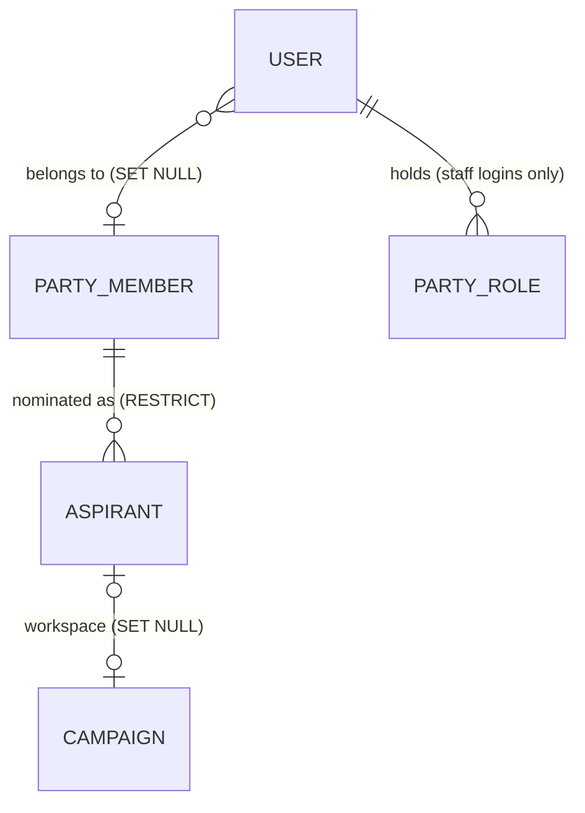

# Release 2: Aspirants and Campaign Workspaces

Technical design for Release 2 of `docs/Implementation_Plan.md`. It builds on
`docs/Identity_Access_Design.md` (Releases 0 and 1) and keeps its principles:
campaign access comes only from `campaign_members`, party access only from
`party_roles`, and one login is on at most one campaign.

Status: approved 1 November 2026; Release 2 done 1 November 2026.

Decisions taken by Jeremy on 1 November 2026:

1. **The Nominations Officer creates the workspace**, and only from an approved
   aspirant record. The superuser keeps the console's campaign creation.
2. **Deleting a campaign keeps the party records.** The campaign and its logins
   go; the aspirant record and the party member stay, the record loses its
   campaign link, and the officer can create a new workspace.
3. **Suspending an aspirant cuts the campaign off** for everyone on it until the
   aspirant is reinstated. Data is kept.
4. **The database refuses a party office on a campaign login** (Release 1 critic
   finding F4), in the first R2 migration.

Proposed in this design, for Jeremy to confirm at review (section 2, "Own
record"): **every officer login is linked to its party member**, and an
unlinked officer login is refused on party routes. There is no real data yet,
so existing officer logins only need linking in the console. The superuser is
exempt from the link and from the own-record refusals (section 2, "Own
record"), and suspending an officer's member stops that officer at once (risk 8).

---

## 1. What exists today

| Piece | Where | What R2 relies on |
|---|---|---|
| Campaign creation | `services/admin.py` `create_campaign` (`:389`) → `services/campaigns.py` `build_campaign` → `services/accounts.py` `new_login`, `join` | Builds campaign, targets and logins, then **commits** (`:422`) and rolls back on `Refused` (`:411`) |
| Campaign deletion | `services/admin.py` `remove_campaign` (`:357`) | Deletes every login on the campaign, then the campaign |
| Party offices | `models/party.py` `PartyRole`, `api/deps.py` `require_party_role` | `nominations_officer` exists, unused |
| Office grant | `services/admin.py` `grant_party_role` | Refuses superusers and campaign logins; the database does not |
| Caller | `api/deps.py` `get_current_user` | Token → active user with `mobilizer_profile`, `party_roles` |
| Guard inventory | `tests/test_route_guards.py` | Every non-public route must depend on `get_current_user` |
| Error shapes | `api/errors.py` | `{"detail": str}` only; unknown `IntegrityError` → 500 |
| Member moves | `services/membership.py` `MOVES`, `set_status`; public withdraw `_apply_withdraw` | Volunteers follow the member; the inbox runs the same statements whatever the register holds (`evals/test_inbox_constant_work.py`) |
| Public sign-up links | `api/routers/join.py` `Link.open` | Reads the event or campaign flag only |
| Frontend | `Gate.jsx`, `api/client.js`, `pages/party/Portal.jsx` | Gate routes superuser → console, campaign → App, office → Portal; the client keeps only the message |

---

## 2. Design

### Principles

1. **An aspirant is a party fact; the campaign is a campaign fact.** The
   aspirant record points at a campaign. Nothing in `api/scope.py` reads it.
2. **A campaign made for an aspirant works only while that aspirant is
   approved.** One check, read fresh, decides it for signed-in routes and for
   the public sign-up links. No status is copied onto the campaign. Campaigns
   made in the console without an aspirant record behave as today.
3. **Staff logins and campaign logins stay apart at the database**, the mirror
   of R0-2.
4. **An officer never acts on their own records**: membership, volunteer
   profile, nomination or workspace.

### Data model



#### R2-1: one migration on `users` and `party_roles`

All `users` changes land in **one** revision, so SQLite rebuilds the table once.
`batch_alter_table` keeps its default `recreate="auto"`: plain `ALTER` on
Postgres, a rebuild on SQLite (as `20261030_..._member_role_fk.py` does).

- `users.kind`: `varchar(8)` NOT NULL, `campaign | staff`, with
  `CHECK (kind IN ('campaign', 'staff'))` and
  `CHECK ((kind = 'staff') = (role IS NULL))`. The migration fills it from
  `role`. It is an ordinary column, not a generated one, so later rebuilds of
  `users` on SQLite stay plain. The model sets it on insert from `role`
  (`new_login` and the test factory both go through the model default).
- Unique constraint `uq_users_id_kind` on `users(id, kind)`.
- `party_roles.kind`: `varchar(8)` NOT NULL default `'staff'`,
  `CHECK (kind = 'staff')`.
- Replace FK `party_roles.user_id → users.id` with composite FK
  `party_roles(user_id, kind) → users(id, kind)`, `ON DELETE CASCADE`,
  `ON UPDATE NO ACTION`.
- `users.party_member_id`: FK `party_members`, NULL, `ON DELETE SET NULL`.
  The link sits on `users`, not on `party_members` as identity design principle
  4 and risk 6 sketched (`party_members.user_id`), because one member can have
  two logins (a staff login and a candidate login). Declared with
  `use_alter=True` with a name, because `party_members.decided_by_id → users`
  closes a cycle and `sorted_tables` warns on it (the suite runs with warnings
  as errors).

Effect: a `party_roles` row for a campaign login fails the composite FK; giving
a campaign role to an officer fails the CHECK unless `kind` changes, and
changing `kind` fails the FK while an office is held. The migration pre-checks
for offending rows and aborts with their ids. Downgrade restores the plain FK
and drops the columns.

Proof: the revision runs on Postgres in the `TEST_POSTGRES=1` lane, plus one
test per refusal on both databases. The tests assert `IntegrityError`, not a
constraint name: through the relationship the CHECK stops an office on a
campaign login, through `PartyRole(user_id=...)` the FK does.

Order inside the revision: add `users.kind` nullable and `party_member_id`;
fill `kind` from `role`; then NOT NULL, both CHECKs, the unique constraint and
the FK; then `party_roles.kind` with `server_default 'staff'`, its CHECK, and
the FK swap. The model default reads `get_current_parameters().get("role")`,
since an ORM insert can leave an unset column out.

#### R2-2: `aspirants`

| Column | Rule |
|---|---|
| `id` | UUID PK |
| `member_id` | FK `party_members`, NOT NULL, `ON DELETE RESTRICT`. The planned member erase deletes the member's nominations that have no workspace, and refuses while one has a workspace (the campaign is deleted first), so an erase can never reopen a locked campaign |
| `seat` | `Seat` |
| `county_id`, `constituency_id`, `ward_id` | FKs `ON DELETE RESTRICT` |
| `status` | `draft, submitted, approved, rejected, withdrawn, suspended`, default `draft` |
| `status_reason` | text NULL |
| `decided_at`, `decided_by_id` | `decided_by_id` FK users `SET NULL` |
| `campaign_id` | FK campaigns, NULL, unique `uq_aspirants_campaign_id`, `ON DELETE SET NULL` |
| `created_by_id` | FK users `SET NULL` |
| `created_at`, `updated_at` | |

Area CHECK `area_matches_seat` (`ck_aspirants_area_matches_seat` after the naming convention), written out in full:

```sql
(seat = 'mca' AND ward_id IS NOT NULL AND constituency_id IS NULL AND county_id IS NULL)
OR (seat = 'mp' AND constituency_id IS NOT NULL AND ward_id IS NULL AND county_id IS NULL)
OR (seat IN ('governor', 'senator', 'women_rep')
    AND county_id IS NOT NULL AND ward_id IS NULL AND constituency_id IS NULL)
```

Indexes: `status`, `member_id`, `seat`. Partial unique
index `uq_aspirants_one_live_per_member` on `member_id`, declared with both
`sqlite_where` and `postgresql_where`:
`status IN ('draft', 'submitted', 'approved', 'suspended')`. A rejected or
withdrawn record stays as history; a new nomination is a new row.

`api/errors.py` maps both constraints to 400, so a race answers with the rule,
never a 500. Each tuple names the Postgres constraint and the SQLite column
text, as the existing tuples do: (`uq_aspirants_one_live_per_member`,
`aspirants.member_id`) → "That member already has a live nomination.";
(`uq_aspirants_campaign_id`, `aspirants.campaign_id`) → "That aspirant already
has a workspace."

### Aspirant status moves

One table in `services/aspirants.py`; any other move is refused; every write is
conditional on the status read.

| From | To | Who | Extra condition |
|---|---|---|---|
| draft | submitted | officer | |
| submitted | approved | officer | member approved |
| submitted | rejected | officer | reason required |
| approved | suspended | officer | reason required |
| suspended | approved | officer | member approved |
| draft, submitted, approved, suspended | withdrawn | officer | |

"Member approved" is read with the member row locked (`FOR UPDATE`), and member
moves lock the same row, so a concurrent member suspension cannot slip between
the check and the write.

Creating an aspirant needs an approved member (read under the same lock) with no
live nomination.

**The aspirant follows the member**, in the member move's transaction, audited
as `system`:

| Member becomes | Live aspirant becomes |
|---|---|
| suspended | approved → suspended; draft, submitted unchanged |
| approved (reinstated) | unchanged; the nominations officer reinstates the aspirant |
| withdrawn, rejected | withdrawn |

Both member-move paths follow: the officer move in `membership.move`
(`services/membership.py:73`), and the public withdrawal in `_apply_withdraw`.
The public path copies `services/volunteers.py` `_withdraw_where`: a
`SELECT id, status ... FOR UPDATE` on the member's live aspirant, an `UPDATE`
gated by `literal(<the withdrawal landed>)` and the live statuses, then
`audit.record_if` on the row count. The same statements run whatever the
register holds. Its audit event is actor `system`, as the volunteer follow
on the same path is, action `aspirant.status`, detail
`{"from": <old status>, "to": "withdrawn"}`.
`evals/test_inbox_constant_work.py` gains an aspirant dimension
(none, and each live status) for the withdraw shapes only, skipping members
who cannot hold a live nomination, so the eval stays small.

Every aspirant route first applies the party inbox (`process_requests`), as the
member routes do, so a queued public withdrawal lands before an officer acts.

### Campaign access (decision 3)

Two dependencies in `api/deps.py`:

- `get_signed_in_user`: what `get_current_user` does today (token → active
  user).
- `get_current_user`: `get_signed_in_user`, then the campaign check below.

`/api/auth/me/` and `/api/auth/logout/` use `get_signed_in_user`; every other
signed-in route keeps `get_current_user`.

The check, for a login with a campaign role only: one query joining
`campaign_members` to `aspirants` on `campaign_id`; if the login's campaign has
an aspirant whose status is not `approved`, raise `CampaignSuspended`. A new
handler in `api/errors.py` answers **403**
`{"detail": <message>, "code": "campaign_suspended"}`, where the message is
"This campaign is suspended by the party." for a suspended aspirant and "This
campaign is closed: its aspirant has withdrawn." for a withdrawn or rejected
one. The code is the same, so the frontend needs one branch.
`contracts/frontend-api.json` lists the shape. The query runs only when
`user.role is not None and not user.is_superuser`: staff logins have no role,
and superusers keep `role = manager` but are never on a campaign.

`tests/test_route_guards.py` treats a route as signed-in if it depends on
either dependency, and adds a second set, `SIGNED_IN_ONLY = {/me, /logout}`,
asserting that exactly those two skip the campaign check.

Public sign-up: `api/routers/join.py` `_link` reads the campaign's aspirant
status in its own query and stores it on `Link` as a plain field (`Link.open`
is a sync property, so it must not touch a lazy relationship). `Link.open` is
false while the campaign's aspirant is not approved, so a suspended campaign collects no supporters. The
public answer stays the same as for any closed link.

### Workspace creation (decision 1)

`POST /api/party/aspirants/{id}/workspace/` (nominations officer or superuser):

1. `services/admin.py` splits `create_campaign` into a non-committing core,
   `build_workspace(session, ...)` (campaign, targets, logins, memberships;
   raises `Refused` and never commits; `new_login` still rolls the session
   back on a username clash, which also discards the rest, so the result stays
   all or nothing), and the console wrapper
   that commits, rolls back and audits as today. Console behaviour is
   unchanged.
2. The aspirant route, in one transaction: `build_workspace` with the
   aspirant's seat and area (not re-entered), a title (default
   `<member name> for <seat label>`, cut to 150 characters, the column's
   length; an officer's title is validated to 1-150), optional election date, a candidate
   login and an optional manager login; then
   `UPDATE aspirants SET campaign_id = :new WHERE id = :id AND campaign_id IS NULL AND status = 'approved'`.
   Unless exactly one row changed, it raises `Refused`. The service catches
   `Refused` around the whole step, calls `session.rollback()` and re-raises,
   as `create_campaign` does (`services/admin.py:410-412`), so the campaign and
   logins go too (the tests share one session, so nothing else rolls it back). That conditional
   update is what closes the double-create race; the unique `campaign_id`
   backs it.
3. The candidate login gets `kind = campaign` and `party_member_id` = the
   aspirant's member. Passwords are returned once. Audited `aspirant.workspace`
   with campaign id and login count.

### Campaign deletion (decision 2)

This reverses identity design risk 6's mitigation ("stop deleting a login that
has a member link") on purpose: the candidate login is campaign-only (an
officer who is also an aspirant has a separate staff login), so deleting it
loses no party access. `remove_campaign` deletes what it deletes today; the FK
sets the aspirant's `campaign_id` to NULL and the login's member link goes with
the login. The console delete adds the aspirant id to its audit detail. The
aspirant keeps its status, and an approved aspirant without a workspace can be
given a new one. `docs/Identity_Access_Design.md` risk 6 is updated to say so.

### Own record (principle 4)

- The superuser links a login to a party member and unlinks it:
  `PUT /api/admin/users/{id}/party-member/` `{member: id | null}`, audited.
  `AdminUserRead` gains `party_member: {id, full_name, status} | null`.
- **Every office holder is a linked, approved party member.** Granting an
  office requires it; the link endpoint refuses to move an office holder's link
  to a member who is not approved, or to remove it; and `require_party_role`
  checks it on every request, so an officer whose member is later suspended or
  withdrawn stops acting at once. The guard first applies the party inbox, then
  reads the member's status fresh, so a queued public withdrawal of the
  officer's own membership stops them on that same request (403, "This login
  needs to be linked to an approved party member."). The superuser
  is exempt from the link and from the own-record refusals: the superuser is
  the party's operator, every superuser action is audited, and Release 1
  decision 1 makes it the Party Super Admin. "No officer acts on their own
  record" means no office holder; this carve-out is part of what Jeremy
  confirms.
- Refused with 403 when the officer's `party_member_id` equals the record's
  member: member status moves, volunteer moves and notes, nominating, aspirant
  moves, and workspace creation. Reads stay allowed.

### Permissions

| Route | Anyone | Campaign user | Membership officer | Nominations officer | Superuser |
|---|---|---|---|---|---|
| `GET /api/party/aspirants/candidates/?q=` | 401 | 403 | 403 | yes | yes |
| `GET /api/party/aspirants/` (status, seat, place; page) | 401 | 403 | 403 | yes | yes |
| `GET /api/party/aspirants/{id}/` | 401 | 403 | 403 | yes | yes |
| `POST /api/party/aspirants/` (member, seat, area) | 401 | 403 | 403 | yes, audited, not own | yes, audited |
| `POST /api/party/aspirants/{id}/status/` | 401 | 403 | 403 | yes, audited, not own | yes, audited |
| `POST /api/party/aspirants/{id}/workspace/` | 401 | 403 | 403 | yes, audited, not own | yes, audited |
| `PUT /api/admin/users/{id}/party-member/` | 401 | 403 | 403 | 403 | yes |
| Campaign routes on a campaign whose aspirant is not approved | | 403 `campaign_suspended` | | | console unchanged |

`/candidates/` is declared before `/{id}/`. It returns approved members with no
live nomination, matched by **name** (case-insensitive substring) or by **exact
full phone**, at most 20, as `{id, full_name, ward}`; never a phone, and no
prefix match, so a phone cannot be recovered digit by digit.

`NominationsOfficer = require_party_role(PartyRoleName.NOMINATIONS_OFFICER)`.

### Frontend

| Where | Change |
|---|---|
| `api/client.js` | Errors carry `status` and `code` as well as the message; the query client does not retry a 403 (`main.jsx` sets `retry: 1` today) |
| `Gate.jsx` | A campaign login whose campaign read fails with `campaign_suspended` gets one screen, "This campaign is suspended by the party", with sign out |
| `pages/party/Portal.jsx` | Menu from every office held: membership officer → Members, Volunteers; nominations officer → Aspirants |
| `pages/party/Aspirants.jsx` | List with filters; "Nominate a member" (name or full-phone search, seat, area picker); detail with status moves and reasons; "Create workspace" on an approved aspirant without one, showing the passwords once |
| `components/Admin.jsx` | "Party member" picker on a login; an Aspirants link that opens `/party/aspirants` |
| Routing | A superuser may open `/party/*` and gets every party menu there (Members, Volunteers, Aspirants); the portal's default route is the first menu entry. Gate sends them to the console otherwise |

---

## 3. Tickets

Migrations run in order (R2-1 → R2-2). Tickets that share files run one after
the other. `frontend/tests/contract.test.js` checks the contract both ways (no
listed route the SPA never calls, no call the contract does not list), so a
route enters `contracts/frontend-api.json` in the frontend ticket that first
calls it: R2-7 for the aspirant routes, R2-8 for the member link, the admin
user field and the `campaign_suspended` shape. A frontend ticket starts after
the backend tickets it calls have merged.

**R2-1 Staff and campaign logins at the database; login → member link** (schema) — done 1 Nov 2026
- Files: `models/user.py`, `models/party.py`, new revision, `tests/factories.py` (new `make_officer(session, world, *roles)`: a staff login linked to a new approved member, holding the offices), `tests/test_party_roles.py`, `tests/test_party_members_api.py`, `tests/test_party_volunteers_api.py` (officer fixtures switch to `make_officer`), `docs/Identity_Access_Design.md` (principle 4, risk 6, the R1 `party_roles` table, the `require_party_role` description).
- Tests: a `party_roles` row for a manager fails at the database; changing an officer's login to a campaign role fails at the database. Both lanes.
- Every later ticket's tests make officers with `make_officer`.

**R2-2 Aspirants table** (schema) — done 1 Nov 2026
- Files: `models/party.py`, `models/enums.py`, `models/__init__.py`, new revision, `api/errors.py` (two constraint messages), `tests/test_models.py`.
- Tests: a second live nomination fails at the database; the area CHECK refuses an MP aspirant with a ward.

**R2-3 Aspirant service and API** (backend) — done 1 Nov 2026
- Files: new `services/aspirants.py`, new `schemas/aspirants.py`, new `api/routers/party_aspirants.py`, `api/routers/__init__.py`, `api/deps.py` (`NominationsOfficer`), `services/membership.py` (officer and public follow), `evals/test_inbox_constant_work.py`, new `tests/test_party_aspirants_api.py`. No contract change (R2-7 adds the routes).
- Tests: only an approved member is nominated; approval refuses a suspended member; a member suspension suspends the approved aspirant; a public withdrawal withdraws it; a membership officer gets 403.

**R2-4 Workspace** (backend) — done 1 Nov 2026
- Files: `services/admin.py` (`build_workspace` split, delete audit), `services/aspirants.py`, `api/routers/party_aspirants.py`, tests.
- Tests: the workspace takes the aspirant's seat and area and links the candidate login; a second request is refused and leaves no campaign; deleting the campaign leaves the aspirant approved without one. The race test runs in the Postgres lane.

**R2-5 Campaign access follows the aspirant** (backend) — done 1 Nov 2026
- Files: `api/deps.py`, `api/errors.py`, `api/routers/auth.py`, `api/routers/join.py`, `tests/test_route_guards.py`, new `tests/test_campaign_access.py`. No contract change (R2-8 adds the shape).
- Tests: a manager on a suspended aspirant's campaign gets 403 `campaign_suspended` and can still read `/me` and log out; reinstating restores access; the sign-up link closes; a console campaign is unaffected.

**R2-6 Own record and console member link** (backend) — done 1 Nov 2026
- Files: `api/deps.py`, `services/admin.py`, `api/routers/admin.py`, `schemas/admin.py`, `services/membership.py`, `services/volunteers.py`, `services/aspirants.py`, `tests/test_party_roles.py` (the grant test links first; an unlinked grant expects 400), new `tests/test_own_record.py`.
- Tests: an officer is refused on their own member, volunteer profile and nomination; an unlinked officer, and one whose member is suspended, gets 403; linking is audited.
- Between R2-6 and R2-8 the console cannot link a login, so offices are granted by API or CLI only; nothing is deployed in between.
- `tests/test_party_roles.py:29-38` refresh `party_member` before calling the guard directly.

**R2-7 Aspirants page** (frontend) — done 1 Nov 2026
- Files: new `pages/party/Aspirants.jsx`, `pages/party/Portal.jsx` (every menu for the superuser; the "needs to be linked" 403 as a message, not an error page), `api/hooks`, `contracts/frontend-api.json` (the aspirant routes), tests.
- Tests: a nominations officer sees Aspirants and not Members; a superuser sees all three; nominating, a status move and the workspace form call the right routes; the passwords show once.
- Depends: R2-3, R2-4, R2-6 merged.

**R2-8 Suspended screen, error codes, console link** (frontend) — done 1 Nov 2026
- Files: `api/client.js`, `main.jsx` (no retry on 403), `Gate.jsx` (the suspended screen; a superuser may open `/party/*`), `components/Admin.jsx`, `contracts/frontend-api.json` (member link, admin user field, `campaign_suspended`), tests.
- Depends: R2-5, R2-6 merged.

**R2-9 Integration** (lead) — done 1 Nov 2026
- Both test lanes, the contract evals, the guard inventory; `docs/SYSTEM.md`; cold isolation critic against section 4.

---

## 4. Rubric for the release critic (frozen before building)

1. Only approved members become aspirants; approval and reinstatement need the member approved, also under a concurrent member suspension.
2. Every route answers as the permissions table says, for anonymous, aspirant, manager, mobilizer, each office, a staff login with no office, an unlinked officer, and the superuser.
3. A campaign whose aspirant is not approved gives 403 `campaign_suspended` on every campaign route for every login on it, and its public sign-up links are closed; `/me` and logout work; reinstating restores both on the next request.
4. A workspace takes the aspirant's seat and area and links the candidate login to the member; two concurrent requests make one campaign and leave no orphan rows.
5. Deleting a campaign leaves the aspirant and member, with `campaign_id` NULL.
6. No officer acts on their own member, volunteer profile, nomination or workspace.
7. The database refuses a party office on a campaign login, a campaign role on an officer login, and a second live nomination.
8. The candidate search never returns a phone or a non-approved member, never matches a phone prefix, and returns at most 20 rows.
9. The public inbox still runs the same statements whatever the register holds, aspirants included.
10. Audit detail holds ids, statuses, seats and counts only.
11. Both test lanes pass; existing campaign, membership and volunteer tests pass unchanged except where this design changes the behaviour.

---

## 5. Risks

| # | Risk | Effect if missed | Mitigation |
|---|---|---|---|
| 1 | The access check adds a query per request | Slower API | One indexed join, skipped for logins without a campaign role |
| 2 | A route skips the check | A suspended campaign keeps working there | The check is inside `get_current_user`; the guard inventory pins the two routes that skip it |
| 3 | A later migration rebuilds `users` on SQLite | Breaks if it meets an unusual column | `kind` is a plain column; the Postgres lane runs every migration |
| 4 | Two officers create a workspace at once | Two campaigns | Conditional update on `campaign_id IS NULL`, whole transaction rolls back |
| 5 | Officer acts on their own record | Conflict of interest | Linked logins only; refusal on every write path |
| 6 | Member suspension suspends a running campaign | A membership decision stops a campaign | Intended; audited as `system`; the aspirant page shows why |
| 7 | Existing officer logins are unlinked | They lose party routes until linked | No real data yet; the console link comes in the same release |
| 8 | Suspending a member who is an officer | Their party access stops at once, so a membership officer can stop another officer | Intended by the link rule; audited; the superuser reinstates. Part of what Jeremy confirms |
| 9 | An aspirant with a workspace is withdrawn, by the officer or by the member's own public withdrawal link | The campaign is locked for good (withdrawn is final) | Intended: the data stays for the party; the superuser deletes the campaign when it is no longer needed |
