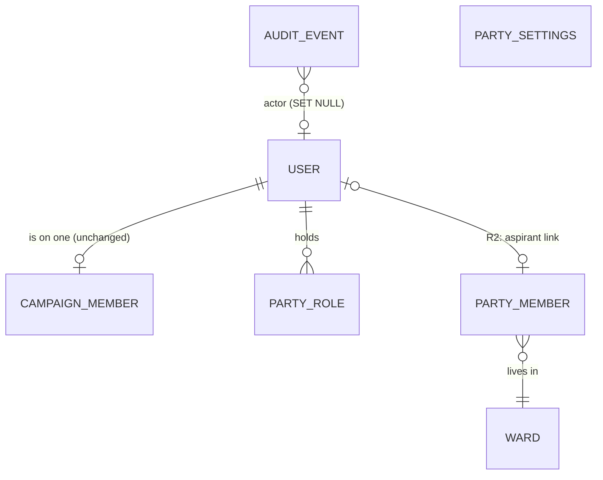

# Identity and access design: Release 0 and Release 1

Status: approved 30 October 2026, decisions in section 7. Release 0 in progress.

Baseline: `main` at `886b0d0`, 30 October 2026. Backend 175 tests pass,
frontend 86 tests pass (run on that commit before writing this).

---

## 1. What the code does today

### Authentication

| Piece | Where | Behaviour |
|---|---|---|
| Login | `api/routers/auth.py` `login` | Username + password, Argon2 (`security.py`). Returns `{token, user}`. |
| Token | `models/auth_token.py` | One token per user (`uq_auth_tokens_user_id`), shared by every device. Logout deletes it. |
| Caller | `api/deps.py` `get_current_user` | Reads `Authorization: Token <key>`, loads `User` and `User.mobilizer_profile`. Inactive user = 401. |
| Login payload | `schemas/auth.py` `LoginUser` | `id, username, full_name, role, is_superuser`. The browser keeps it in localStorage (`frontend/src/store/auth.js`) and never refreshes it. |

### Users and roles

- `users.role` (`models/user.py`): `candidate | manager | mobilizer`, NOT NULL,
  default `manager`. "Aspirant" in every doc is `UserRole.CANDIDATE` in code.
- `users.is_superuser`: the operator. Never on a campaign
  (`services/accounts.py` `membership_refusal`).
- `campaign_members.role` (`models/membership.py`): a second copy of the role,
  written once from `users.role` by `services/accounts.py` `add_member`.

**The role is stored twice and read from different copies:**

| Reads `users.role` | Reads `campaign_members.role` |
|---|---|
| Every role guard: `api/deps.py` `require_role` (`Writer`, `MobilizerWriter`, `TeamWriter`, `SupporterTeam`), `api/routers/team.py` `Aspirant` | Unique indexes `uq_campaign_members_one_candidate`, `uq_campaign_members_one_manager` |
| `api/scope.py` `mobilizer_ward_id`, `own_ground_row` | `services/team.py` `manager_of` |
| `api/routers/events.py:56` (hide sign-up code from candidate) | `services/admin.py` `remove_member` (refuses the candidate) |
| `api/routers/payments.py:38` (mobilizer sees own) | `services/admin.py` `campaigns` (member list) |
| `api/routers/mobilizers.py:62`, `api/routers/users.py:61` | `seed/demo.py:80` |
| | `models/campaign.py:75` `Campaign.candidate` (public join page, campaign list `candidate_name`) |
| `services/accounts.py` `membership_refusal`, `services/team.py` `resettable`, `team` sort | |

They agree today only because nothing ever updates `users.role` after
`add_member` copies it. No constraint holds them equal.

### Campaign membership and isolation

- One login, at most one campaign: unique index
  `uq_campaign_members_one_campaign_per_user` on `campaign_members(user_id)`.
- Scope: `api/scope.py` `visible_campaign_ids` is one query on
  `campaign_members`; `require_visible_campaign` answers 404 for any campaign
  the caller is not on; `scoped` adds the mobilizer's ward.
- Admin routes (`api/routers/admin.py`) check `is_superuser` only
  (`AdminUser`).

### Campaign creation

- `services/admin.py` `create_campaign` → `services/campaigns.py`
  `build_campaign` (campaign + targets) → `services/accounts.py` `new_login`
  for the aspirant (role candidate) and optional manager → `add_member`.
- Only from `POST /api/admin/campaigns/` (superuser) and the CLI
  `campaign-crm campaign`.
- `services/admin.py` `remove_campaign` deletes every login on the campaign,
  the aspirant included.

### Frontend gate

- `frontend/src/main.jsx` picks Join / Withdraw / Root by regex on the path.
  No router.
- `frontend/src/Gate.jsx`: no token → Login; superuser → `Admin`; on no
  campaign → "You are not on a campaign yet"; else `App`.
- `frontend/src/App.jsx` (1,075 lines): navigation by `NAV[user.role]`, falls
  back to the candidate menu for any unknown role (`App.jsx:978-979`). Uses the
  first campaign returned (`App.jsx:985`).

---

## 2. Mismatches between the code and `docs/SYSTEM.md`

| # | SYSTEM.md says | Code does |
|---|---|---|
| 1 | 164 backend tests, 79 evals, 243 total, 81 frontend tests | 175 tests pass, 268 collected (93 evals incl. live checks), 86 frontend tests |
| 2 | "One login belongs to exactly one campaign" (section 2) | At most one; superusers and unattached logins exist (section 5 states it correctly) |
| 3 | Roles are a single concept | Role stored in `users.role` and `campaign_members.role`, read from different copies (section 1 above) |
| 4 | "Only the operator creates aspirant logins, with the campaign" | `campaign-crm createuser --role candidate` (`cli.py:251`) makes a candidate login with no campaign; the console refuses the same (`services/admin.py` `create_user`) |
| 5 | Not mentioned | A login with no campaign defaults to role `manager` (`models/user.py`), including a superuser made by the CLI |
| 6 | Public pages open "by their own address" | Only `/join/{code}` and `/withdraw/{code}` have a server fallback (`main.py` `_mount_spa`). Any new SPA path 404s on a hard refresh in production |
| 7 | `App.jsx` about 1,000 lines | 1,075 lines |
| 8 | UI labels | The frontend labels the role "Candidate" (`App.jsx:972`); server messages say "aspirant" |

`KNOWN-GAPS.md` (git-ignored) is stale: it lists `PollingStation` (no such
model), "Mobilizer has no uniqueness rule" (it has two unique indexes), "no
public sign-up form" (`/join/{code}` exists) and `POST /setup/` (no such
route). It needs a rewrite, not a patch.

No audit log exists. The only logging is `logger.error` in
`api/routers/payments.py` and `logger.info` in `services/sms.py`.

---

## 3. What allowing member / aspirant / campaign user touches

The person can be (a) a party member, (b) an aspirant, (c) a campaign user
limited to their own campaign.

**Key finding: the one-login-one-campaign rule does not need to change.** An
aspirant still works exactly one campaign. What changes is that a person gains
party-level facts (membership record, party staff roles) that sit beside the
campaign membership, never inside it.

### Affected items

| Kind | Item | Why it is affected | Release |
|---|---|---|---|
| Model | `models/user.py` `User.role` | Party staff have no campaign role; NOT NULL + default `manager` mislabels them | R1 |
| Model | `models/membership.py` `CampaignMember` | Role copy must be held equal to `users.role` | R0 |
| Model | new `PartySettings`, `PartyMember`, `PartyRole`, `AuditEvent` | New | R0/R1 |
| Model | `models/supporter.py` | Consent wording and channel not recorded | R0 |
| Rule | `uq_campaign_members_one_campaign_per_user` | **Kept unchanged** | none |
| Rule | `membership_refusal` (superuser never on a campaign) | Kept; party officers are not superusers | none |
| Rule | `remove_campaign` deletes the aspirant's login | In R2 that login carries a party identity | R2 (flagged now) |
| Guard | `api/deps.py` `require_role` | Crashes on `role=None` (`user.role.label`) | R1 |
| Guard | new `require_party_role` | Party officer access | R1 |
| Scope | `api/scope.py` | No change. Party data never goes through campaign scope | none |
| Route | `api/routers/auth.py` | `LoginUser` gains `party_roles`; `role` becomes nullable; add `GET /api/auth/me/` | R1 |
| Route | `api/routers/admin.py` | Party settings, party role grant/revoke, audit read | R0/R1 |
| Route | new `api/routers/party.py` | Public settings, join, withdraw; member management | R1 |
| Route | `main.py` `_mount_spa` | SPA fallback for new paths | R0 |
| CLI | `cli.py` `createuser`, `users` | Print null role; optional party role flag | R1 |
| Screen | `main.jsx`, `Gate.jsx` | Router; routing by `party_roles` | R0/R1 |
| Screen | `App.jsx` | Split into pages; drop the candidate fallback | R0/R1 |
| Screen | `components/Admin.jsx` | Party settings, party roles on users | R1 |
| Screen | `components/Join.jsx`, `App.jsx` `RegisterSupporterForm` | Show server-supplied consent wording | R0 |
| Contract | `contracts/frontend-api.json` | Every new/changed field | R0/R1 |
| Migration | `alembic/versions/` | One additive revision per schema ticket, chained in a fixed order | R0/R1 |
| Test | `tests/test_models.py` `test_a_login_cannot_be_on_two_campaigns` | Must keep passing | guard |
| Test | `tests/test_campaigns_api.py` `test_everyone_on_a_campaign_sees_it_and_not_a_rival_s` | Must keep passing | guard |
| Test | `tests/test_admin_api.py` (8), `test_team_api.py` (6), `test_users_api.py` (3), `test_auth_api.py` (6) | Touch roles, logins, membership; must keep passing | guard |
| Test | `tests/test_migrations.py` | Single chain, schema equals models; catches parallel migrations | guard |
| Test | `tests/conftest.py`, `tests/factories.py` `make_user` | Default role manager stays for campaign tests | R1 |
| Test | `frontend/tests/helpers.jsx` `signIn(role)` | Login fixture gains `party_roles: []` | R1 |
| Test | `frontend/tests/gate.test.jsx`, `app.test.jsx`, `join.test.jsx` | Gate branches and router | R0/R1 |

---

## 4. Design

### Principles

1. **Two scopes, two tables, never mixed.** Campaign access comes only from
   `campaign_members` (as today). Party access comes only from `party_roles`
   (new). No route accepts either one as a substitute for the other.
2. **Superuser = Party Super Admin.** The existing `is_superuser` flag is the
   Party Super Admin role. No second all-powerful flag.
3. **Party member ≠ login ≠ supporter.** `party_members` is a register of
   people; most will never sign in. Supporters stay per campaign, untouched.
4. **One login, one campaign, unchanged.** An aspirant is a login with role
   `candidate` on one campaign, later linked from their `party_members` row
   (R2).
5. **No party id anywhere.** One deployment, one party; `party_settings` is a
   singleton.
6. **A party staff login is never on a campaign**, the same rule the superuser
   already follows. Party staff logins have `role = NULL`, and the R0-2
   composite FK makes a NULL-role login impossible on a campaign at the
   database. Granting a party role refuses a login with a campaign role.
   Reason: three existing campaign actions end a login, and would silently
   end an officer's party access with it: `services/team.py` `set_manager`
   turns the replaced manager off, `services/admin.py` `remove_campaign`
   deletes every login on the campaign, `api/routers/users.py` `delete_user`
   deletes a mobilizer's login. A person who is both an officer and an
   aspirant (R2) gets two logins, both linked to their one `party_members`
   row.

### Data model

#### R0: `campaign_members` role held equal to `users.role`

- Add unique constraint `uq_users_id_role` on `users(id, role)`.
- Replace FK `campaign_members.user_id → users.id` with composite FK
  `campaign_members(user_id, role) → users(id, role)`, `ON DELETE CASCADE`,
  `ON UPDATE NO ACTION`.
- Effect: changing a member's `users.role` fails at the database; a login with
  `role = NULL` (R1) can never be on a campaign. Guards and indexes can no
  longer disagree.
- Migration pre-checks for mismatched rows and aborts with the offending ids
  if any exist.
- Postgres checks a composite FK only when every column is non-NULL (MATCH
  SIMPLE). Both child columns are NOT NULL, so every member row is checked.
- SQLite needs `op.batch_alter_table(..., recreate="always")` to swap the FK;
  Postgres uses plain `ALTER TABLE`. Postgres default `ON UPDATE NO ACTION`
  is what refuses a role change on a member.
- No code path writes `users.role` after creation today (checked: every
  write is in `new_login`, `make_user`, or the demo seed). The FK keeps it so.

#### R0: `audit_events`

| Column | Type | Rule |
|---|---|---|
| `id` | UUID PK | |
| `created_at` | timestamptz | server default now |
| `actor_id` | UUID FK users, NULL | `ON DELETE SET NULL` |
| `actor_name` | varchar(150) | username snapshot, or `cli` |
| `action` | varchar(60) | dotted name, e.g. `campaign.create`, `member.approve` |
| `subject_type` | varchar(40) | `user`, `campaign`, `party_member`, `party_settings` |
| `subject_id` | UUID NULL | no FK, so the trail outlives the row |
| `campaign_id` | UUID NULL | no FK, same reason |
| `detail` | JSON | ids, counts, statuses only; never names or phones |

Index on `(subject_type, subject_id)` and on `created_at`. Written through
`services/audit.py` `record(...)` inside the caller's transaction, so a
rolled-back action leaves no audit row. No update or delete route.

#### R0: consent on `supporters`

- `consent_channel`: `event_qr | campaign_link | mobilizer`, NULL for rows
  created before this migration.
- `consent_wording`: text, NULL for older rows.
- Wording lives once in `services/consent.py`, keyed by channel. The server
  writes the wording it served; the client never sends it. `GET
  /api/join/{code}/` returns `consent_wording`, so screen and record match.
  The one window where they can differ is a page loaded before a deploy that
  changes the wording and submitted after it; the record then holds the new
  wording. Accepted for R0; a `consent_version` echoed by the client closes
  it if the party's counsel asks.
- The two wordings stay as they read today; R0 records them, it does not
  rewrite them.

#### R1: `users.role` nullable

- `ALTER COLUMN role DROP NOT NULL`; existing rows keep their values. Model
  default stays `manager` only in test factories; `new_login` already requires
  `role` explicitly, and accepts `None`.
- `require_role` treats `None` as "no campaign role": 403 with a fixed message.
- `LoginUser.role: UserRole | None`.
- Existing superusers keep `role = manager`; no backfill, so no console or
  CLI behaviour moves. New party staff logins are created with `role = NULL`.
- Every `.role.label` / `.role.value` on a `User` handles `None`:
  `api/deps.py:54`, `models/user.py:50` `__str__`, `cli.py:133` `users`.

#### R1: `party_settings` (singleton)

| Column | Type |
|---|---|
| `id` | integer PK, `CHECK (id = 1)` |
| `name`, `short_name` | varchar |
| `logo_url` | varchar (a URL or `/static/...` path; uploads are later) |
| `primary_colour`, `secondary_colour` | varchar(7), `CHECK` `#rrggbb` |
| `contact_email`, `contact_phone`, `address` | varchar |
| `description`, `manifesto_text` | text |
| `manifesto_url` | varchar |
| `social_links` | JSON object `{name: url}` |
| `updated_at` | timestamptz |

The migration inserts row `id = 1` with placeholder name, so reads never
handle "missing".

#### R1: `party_roles`

| Column | Rule |
|---|---|
| `user_id` | FK users `ON DELETE CASCADE` |
| `role` | `membership_officer | nominations_officer | finance_officer` (CHECK) |
| `created_at` | |
| | unique `(user_id, role)` |

All three values exist from R1 so R2/R3 need no CHECK migration; only
`membership_officer` is used by R1 routes.

#### R1: `party_members`

| Column | Rule |
|---|---|
| `id` | UUID PK |
| `full_name` | NOT NULL, non-empty |
| `phone` | NOT NULL, `+254…`, **unique** |
| `email` | NULL |
| `ward_id` | FK wards, NOT NULL, `ON DELETE RESTRICT`. County and constituency come from the ward, so they cannot disagree |
| `status` | `pending | approved | rejected | suspended | withdrawn`, default `pending` |
| `status_reason` | text NULL |
| `decided_at`, `decided_by_id` | `decided_by_id` FK users `SET NULL` |
| `consent_wording` | text NOT NULL, `CHECK <> ''` |
| `consent_channel` | `web_form | officer_entry`, NOT NULL |
| `consent_at` | timestamptz NOT NULL |
| `withdraw_code` | unique, NULL for officer-entered rows |
| `created_at` | application date |

Indexes: `status`, `ward_id`, `full_name`.

Status moves (enforced in `services/membership.py`, one table, no others
allowed):

| From | To | Who |
|---|---|---|
| pending | approved, rejected | officer |
| approved | suspended | officer |
| suspended | approved | officer |
| approved, suspended | withdrawn | the member (withdraw link) or officer |
| rejected, withdrawn | pending | the person re-applying from the public form |

Every officer move writes an audit event with old and new status.

### Permissions

| Route | Anyone | Campaign user | Membership officer | Superuser |
|---|---|---|---|---|
| `GET /api/party/` (public settings) | yes | yes | yes | yes |
| `POST /api/party/join/` | yes, rate limited | yes | yes | yes |
| `POST /api/party/withdraw/{code}/` | yes, same answer always | | | |
| `GET /api/party/members/` (search, filter, page) | 401 | 403 | yes | yes |
| `GET /api/party/members/{id}/` | 401 | 403 | yes | yes |
| `POST /api/party/members/{id}/status/` | 401 | 403 | yes | yes |
| `GET /api/party/members/export.csv` | 401 | 403 | yes, audited | yes, audited |
| `PUT /api/admin/party/` | 401 | 403 | 403 | yes |
| `POST/DELETE /api/admin/users/{id}/party-roles/` | 401 | 403 | 403 | yes |
| `GET /api/admin/audit/` | 401 | 403 | 403 | yes |
| Every existing campaign route | unchanged | unchanged | 404 / empty (no membership) | unchanged |

`require_party_role(*roles)` in `api/deps.py`: passes a superuser or a user
holding one of `roles`; otherwise 403. `get_current_user` eager-loads
`User.party_roles` alongside `mobilizer_profile`.

### Frontend routes

| Path | Who | Release |
|---|---|---|
| `/join/:code`, `/withdraw/:code` | public | unchanged |
| `/join-party`, `/party/withdraw/:code` | public | R1 |
| `/` | signed in: Gate picks the home | R0 |
| `/campaign/:page` | campaign users, page in their `NAV` | R0 |
| `/party/members` | membership officer, superuser | R1 |
| `/admin/*` | superuser | R0 (existing console) |

Gate order: superuser → `/admin`; else campaign membership → `/campaign`; else
any party role → `/party`; else "not on a campaign yet". Server
`_mount_spa` returns `index.html` for any non-`/api` GET that is not a file.

---

## 5. Tickets

Rules for every Sonnet ticket: read the named files and their tests first;
change only the listed files; one or two tests that prove the behaviour; run
`cd backend && uv run pytest tests` and/or `cd frontend && npm test`; report
files changed, tests run, assumptions.

**Migrations are serialised.** Two agents writing revisions in parallel give
two heads and fail `test_revisions_form_a_single_chain`. Schema tickets run in
this order, each on top of the last: R0-2 → R0-3 → R0-5 → R1-1 → R1-2 → R1-3 →
R1-4. Non-schema tickets run in parallel with them.

### Release 0

**R0-1 Truth-up the docs** (lead, no code) — done 30 Oct 2026
- Files: `docs/SYSTEM.md`, `KNOWN-GAPS.md`.
- Fix mismatches 1-8 in section 2; rewrite stale gaps.
- Accept: every number and path in the edited sections checked against the code.
- Depends: none.

**R0-2 Hold the member role equal to the user role** (Sonnet, schema) — done 30 Oct 2026
- Files: `models/user.py`, `models/membership.py`, new revision, `tests/test_models.py`.
- Migration: unique `(id, role)` on users; composite FK on `campaign_members`; pre-check query.
- API: none. Permissions: none.
- Tests: changing `users.role` of a campaign member fails with `IntegrityError`.
- Accept: all 175 backend tests pass; migration tests pass; Postgres SQL renders the composite FK.
- Postgres proof (gate item): on the local Postgres, `campaign-crm seed` + `demo`, then `alembic upgrade head`, an `UPDATE users SET role='mobilizer'` on the demo manager refused, `alembic downgrade -1` and `upgrade head` again clean; a hand-made mismatched row makes the upgrade abort naming it. Commands and output pasted in the ticket report.
- Depends: none.

**R0-3 Audit log** (Sonnet, schema) — done 30 Oct 2026
- Files: new `models/audit.py`, `models/__init__.py`, new `services/audit.py`, new `schemas/audit.py`, `api/routers/admin.py`, new revision, new `tests/test_audit.py`, `contracts/frontend-api.json` only if the console reads it (not in R0).
- API: `GET /api/admin/audit/?subject_type=&subject_id=&limit=` superuser only.
- Tests: an action that rolls back leaves no audit row; a non-superuser gets 403 on the read.
- Accept: `record()` adds to the session without committing.
- Depends: R0-2 (migration order only).

**R0-4 Audit the existing sensitive actions** (Sonnet) — done 30 Oct 2026
- Files: `services/admin.py`, `services/team.py`, `api/routers/admin.py`, `api/routers/team.py`, `api/routers/users.py`, `cli.py`, `tests/test_audit.py`.
- Actions: `campaign.create`, `campaign.delete`, `campaign.rename`, `user.create`, `user.reset_password`, `user.activate`, `user.deactivate`, `member.add`, `member.remove`, `team.set_manager`, `team.reset_password`, `mobilizer_login.create`, `mobilizer_login.delete`.
- Service functions take `actor: User | None`; CLI passes `None` (recorded as `cli`).
- Tests: one parametrised test asserting each console action writes its event.
- Accept: no response body or status changes; existing tests untouched except call sites.
- Depends: R0-3.

**R0-5 Record the consent wording and channel for supporters** (Sonnet, schema, backend) — done 30 Oct 2026
- Files: new `services/consent.py`, `models/supporter.py`, `api/routers/join.py`, `api/routers/supporters.py`, `schemas/join.py`, new revision, `contracts/frontend-api.json`, `tests/test_join_api.py`.
- API: `GET /api/join/{code}/` adds `consent_wording`. `GET /api/supporters/consent-wording/` (SupporterTeam) for the mobilizer form.
- Tests: a QR sign-up stores the wording that `GET` served and channel `event_qr`.
- Accept: older rows stay NULL; client cannot set wording.
- Depends: R0-3 (migration order).

**R0-6 Show server consent wording on both screens** (Sonnet, frontend) — done 30 Oct 2026
- Files: `frontend/src/components/Join.jsx`, `frontend/src/App.jsx` (`RegisterSupporterForm` only), `frontend/src/api/hooks.js`, `frontend/tests/join.test.jsx`.
- Tests: the checkbox label is the wording the API returned.
- Depends: R0-5.

**R0-7 SPA fallback** (Sonnet, backend) — done 30 Oct 2026
- Files: `main.py`, `tests/test_app.py`.
- Behaviour: any GET outside `/api` with no static file returns `index.html`; `/api/*` unknown still 404 JSON.
- Tests: `/campaign/events` returns the index; `/api/nope/` returns 404.
- Depends: none.

**R0-8 Router** (Sonnet, frontend) — done 30 Oct 2026
- Files: `frontend/package.json` (add `react-router-dom` pinned), `frontend/src/main.jsx`, `frontend/src/Gate.jsx`, `frontend/tests/app.test.jsx`, `frontend/tests/gate.test.jsx`.
- Behaviour: same three entry points by route; no page changes.
- Tests: `/join/x` renders Join; `/` renders the gate.
- Depends: none (R0-7 for production refresh).

**R0-9 Portal layout and shared UI pieces** (Sonnet, frontend) — done 30 Oct 2026
- Files: `frontend/src/App.jsx`, new `frontend/src/components/PortalLayout.jsx`, `frontend/src/components/ui/index.jsx`, `frontend/tests/styles.test.js` must pass.
- Moves `Badge`, `Bar`, `Chip`, `Modal`, `PasswordModal`, `PageTitle` to `components/ui`; topbar + sidebar to `PortalLayout` (props: brand, title, meta, user line, nav, children).
- Tests: existing 86 pass unchanged.
- Depends: none; must not run at the same time as R0-10.

**R0-10 Split `App.jsx` into routed pages** (Sonnet, frontend) — done 30 Oct 2026
- Files: `frontend/src/App.jsx`, new `frontend/src/pages/campaign/*.jsx` (one per `NAV` key and per form), `frontend/tests/*` only where a test navigates.
- Routes `/campaign/:page`; a page not in the role's `NAV` redirects to the first; unknown role shows the no-campaign screen instead of the candidate menu.
- Tests: a manager opening `/campaign/team` is sent to their first page.
- Accept: every existing frontend test passes; `App.jsx` holds routing only.
- Depends: R0-8, R0-9.

**R0-11 Route guard inventory test** (Sonnet, backend) — done 30 Oct 2026
- Files: new `tests/test_route_guards.py`.
- Lists every route on `app` and asserts each one depends on exactly one of: `get_current_user` (directly or through a guard), `require_superuser`, or is in a short public allowlist (`/health`, `/api/auth/login/`, `/api/join/*`, later `/api/party/` public routes).
- Tests: the test itself; adding an unguarded route fails it.
- Depends: none.

### Release 1

**R1-1 Logins without a campaign role** (Sonnet, schema)
- Files: `models/user.py`, `api/deps.py`, `schemas/auth.py`, `schemas/admin.py`, `cli.py`, `services/admin.py` (`users` print), new revision, `contracts/frontend-api.json`, `tests/test_auth_api.py`.
- API: `LoginUser.role` nullable; `AdminUserRead.role` nullable.
- Tests: a login with no role gets 403 (not 500) on a `Writer` route and 404 on `GET /api/campaigns/{id}/`.
- Depends: R0-2, R0-5 (migration order).

**R1-2 Party settings** (Sonnet, schema)
- Files: new `models/party.py`, new `schemas/party.py`, new `api/routers/party.py`, `api/routers/admin.py`, `api/routers/__init__.py`, new revision, `contracts/frontend-api.json`, new `tests/test_party_settings.py`.
- API: `GET /api/party/` public; `PUT /api/admin/party/` superuser, audited `party_settings.update`.
- Tests: public read works without a token; a manager gets 403 on the write.
- Depends: R0-3, R1-1 (order).

**R1-3 Party roles and the party guard** (Sonnet, schema)
- Files: `models/party.py`, `models/user.py` (relationship), `api/deps.py` (`require_party_role`, `MembershipOfficer`, eager load), `api/routers/auth.py` (`GET /api/auth/me/`), `schemas/auth.py` (`party_roles`), `api/routers/admin.py`, `services/admin.py`, new revision, `contracts/frontend-api.json`, new `tests/test_party_roles.py`.
- API: `POST /api/admin/users/{id}/party-roles/` `{role}`, `DELETE …/party-roles/{role}/`; both audited. `POST /api/admin/users/` accepts `role: null` for a staff login.
- Rule: granting refuses a login with a non-NULL `role` or a superuser (principle 6).
- Tests: an officer passes the guard and sees no campaign; a candidate gets 403 from the guard; granting a role to a manager login is refused.
- Depends: R1-1, R0-3.

**R1-4 Party member register** (Sonnet, schema)
- Files: `models/party.py`, new `services/membership.py`, `services/consent.py` (party wording), new revision, new `tests/test_membership_service.py`.
- Tests: an illegal move (pending → suspended) is refused; the database refuses a second member with the same phone.
- Depends: R1-3 (order), R0-5 (consent module).

**R1-5 Public join and withdraw** (Sonnet)
- Files: `api/routers/party.py`, `schemas/party.py`, `services/membership.py`, `contracts/frontend-api.json`, new `tests/test_party_join_api.py`.
- API: `POST /api/party/join/` `{full_name, phone, email?, ward, consent_given}` → `{withdraw_url}`; `POST /api/party/withdraw/{code}/`.
- Rules: consent required; Kenyan number normalised; rate limited with `services/ratelimit.py`; existing phone gets the same answer and a link that does nothing, rejected/withdrawn rows go back to pending with fresh consent.
- Tests: no consent is 400; a repeat phone answers the same as a new one.
- Depends: R1-4.

**R1-6 Member management API** (Sonnet)
- Files: `api/routers/party.py`, `schemas/party.py`, `services/membership.py`, `contracts/frontend-api.json`, new `tests/test_party_members_api.py`.
- API: list with `q`, `status`, `county`, `constituency`, `ward`, `limit`, `offset`; detail; `POST /status/` `{status, reason}`; `GET export.csv`.
- Audit: every status move; export with filters and row count.
- Tests: one parametrised test: aspirant, manager and mobilizer get 403 on every member route; an officer approves a pending member.
- Depends: R1-3, R1-5.

**R1-7 Join the Party page** (Sonnet, frontend)
- Files: new `frontend/src/pages/public/JoinParty.jsx`, `frontend/src/main.jsx`, `frontend/src/api/hooks.js`, new `frontend/tests/joinParty.test.jsx`.
- Tests: submit stays off until consent is ticked; thank-you shows the withdraw link.
- Depends: R0-8, R1-5.

**R1-8 Party portal: members page** (Sonnet, frontend)
- Files: new `frontend/src/pages/party/Members.jsx`, `frontend/src/Gate.jsx`, `frontend/src/api/hooks.js`, `frontend/tests/helpers.jsx`, new `frontend/tests/members.test.jsx`.
- Tests: an officer sees the list and approves; a login with `party_roles: []` never sees the page.
- Depends: R0-9, R0-10, R1-6.

**R1-9 Console: party settings and officer roles** (Sonnet, frontend)
- Files: `frontend/src/components/Admin.jsx`, `frontend/src/api/hooks.js`, `frontend/tests/admin.test.jsx`.
- Tests: granting Membership Officer calls the endpoint and shows the role.
- Depends: R1-2, R1-3.

**R1-10 Integration** (lead)
- Run every suite, the contract evals, the route guard test; update `docs/SYSTEM.md`; cold critic pass on isolation (attacker probes every new route with each role).

---

## 6. Risks

| # | Risk | Effect if missed | Mitigation |
|---|---|---|---|
| 1 | Guards read `users.role`, indexes read `campaign_members.role` | A role change on the user silently changes permissions on a campaign | R0-2 composite FK |
| 2 | `role = NULL` reaches `user.role.label` | 500 on campaign write routes | R1-1 test on a `Writer` route |
| 3 | `None is not MOBILIZER` skips the ward filter in `scope.py` | Would widen a read if a null-role login were on a campaign | R0-2 makes that impossible at the database |
| 4 | A future "party admin sees campaigns" shortcut through `visible_campaign_ids` | Breaks campaign isolation for every campaign | Party roles never feed campaign scope; R4 dashboards read aggregates through their own service; R0-11 inventory test |
| 5 | New routes added without a guard | Open data | R0-11 |
| 6 | `remove_campaign` deletes the aspirant's login | In R2 deletes the party-linked login and its party roles | R2 must stop deleting a login that has party roles or a member link; `party_members.user_id` `SET NULL` |
| 7 | Member export | Largest PII leak path | Officer and superuser only; every export audited with filters and count |
| 8 | Public join form | Phone enumeration, spam | Same answer for new and existing; rate limit; officer review gates approval. Rate limit resets on restart and is shared behind one NAT (known) |
| 9 | Audit rows mutable by code | Weak trail | No update/delete path; Postgres trigger can be added later if required |
| 10 | Stale role in localStorage | Wrong menu until re-login (server still enforces) | `GET /api/auth/me/` on load (R1-3) |
| 11 | Parallel migration tickets | Two heads | Fixed migration order (section 5) |
| 12 | Hard refresh on new SPA paths | 404 in production | R0-7 |
| 13 | Downgrade of R1-1 | `NOT NULL` fails if null roles exist | Downgrade deletes `party_roles` first and refuses with a clear message if null-role logins remain |
| 14 | An officer's login also on a campaign | `set_manager`, `remove_campaign` or `delete_user` silently ends their party access | Principle 6: staff logins have `role = NULL`, which the composite FK keeps off every campaign |
| 15 | Composite FK proven only by rendered SQL | Fails on the real Neon upgrade at Fly's release step | R0-2 Postgres proof run on local Postgres before merge |
| 16 | Superusers keep `role = manager` | They pass `Writer` guards; harmless today because scope is empty, and unchanged | Left as is to keep console behaviour; R0-11 inventory test keeps every campaign route scoped |

---

## 7. Decisions (approved 30 October 2026)

1. **Party Super Admin is `is_superuser`.** No fourth party role.
2. **A party officer may also be an aspirant, on two logins** (principle 6),
   both linked to their one `party_members` row in R2. R2 refuses any officer
   action on their own record.
3. **Withdrawn keeps the row** with status `withdrawn`. A separate
   superuser-only erase deletes it on a data erasure request, audited by id
   only.
4. **No national ID number in R1.** It is one nullable column when the party
   asks for it.
5. **Router: `react-router-dom`**, pinned.
