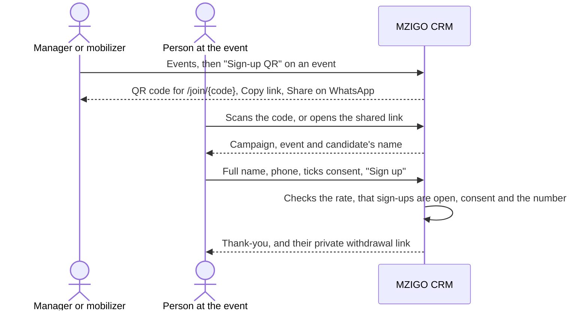
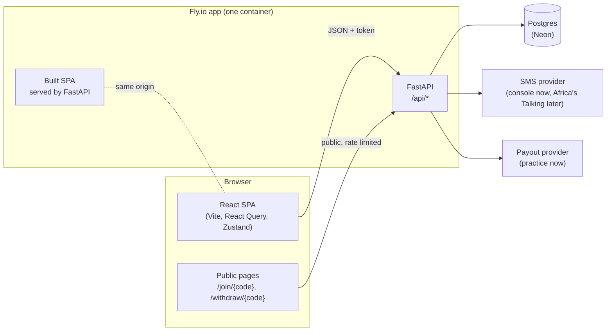

# MZIGO CRM: system brief

What this system is, who it is for, what it does today, and how it is built.
Use it to plan features, refine the architecture, or bring someone new up to
speed. How to run the code lives in the READMEs; this document says what the
code is for.

Last checked against the code: 24 October 2026, commit `dc71b22`.

---

## 1. The concept

A Kenyan election campaign wins or loses unit by unit. MZIGO CRM gives a
campaign one number to chase, the **win number**, and breaks it down to the
places the team actually works:

- an **MP, Governor, Senator or Women Rep** race is worked **ward by ward**;
- an **MCA** race is worked **registration centre by registration centre**,
  inside its one ward.

For each unit the app knows the registered voters (from the real 2022
register), assumes the county's 2022 turnout, and sets the target at half the
projected votes plus one. The team then records the work that moves those
numbers: mobilizers on the ground, events held, and supporters signed up. The
app reads all of it back as one picture: how far along the campaign is, which
units carry the most of the win number, which are behind, and which have nobody
working them.

### The goal

Give a campaign team a single, honest answer to "are we winning, and where do
we go next?", computed from its own records, never from guesses typed into a
spreadsheet.

### How progress is measured

**Progress is supporters, not activity.** A unit's progress is the number of
people on the supporter register with support level **Supporter** filed under
that unit, divided by its target.

| Counts toward progress | Does not count |
|---|---|
| A new supporter registered by the team at level Supporter | Undecided or Opposed people on the register |
| A new person who signs up through an event's QR code (saved as Supporter) | An event's invited (`number_reached`) or attended numbers |
| In an MCA race: a supporter filed at a centre that has a target | In an MCA race: a supporter with no centre, or at a centre with no target |

Events shape the **advice**, not the score: the strategy notes name the unit
with the biggest gap and say whether it has had events or a mobilizer, and tell
the team to ease off a unit that has met its target after 4 or more events.

The read is computed fresh on every request (`backend/src/backend/services/strategy.py`)
and nothing about it is stored, so the screen can never disagree with the rows
underneath it.

---

## 2. Who it is for, and how it is sold

**Sold on subscription to several campaigns at once.** Each campaign has its own
aspirant, manager, mobilizers and supporters, and never sees another campaign's
data. One login belongs to exactly one campaign.

**The operator (superuser) onboards every campaign.** There is no public
sign-up. The operator creates a campaign from the admin console, which also
creates the aspirant's login and, optionally, the manager's. From then on the
campaign runs its own team.

| Person | What they do in the app |
|---|---|
| **Operator** (superuser) | Runs the deployment from the admin console: creates campaigns and their first logins, repairs logins, deletes campaigns. Never sits on a campaign. |
| **Aspirant** (candidate) | Owns the campaign. Watches progress and strategy, adds or replaces the one manager, adds and places mobilizers, resets the team's passwords. |
| **Campaign manager** | Runs the day to day: targets, events, the supporter register, sign-up links to share, payments to mobilizers, adding mobilizers and resetting their passwords. |
| **Mobilizer** | Works one unit: a ward, or in an MCA race a registration centre. Records events and registers supporters in their ward, and sees their own payments. |
| **Supporter** (no login) | Signs up on their own phone, from an event's QR code or the campaign's sign-up link, and withdraws with their private link; or is registered by a mobilizer. |

---

## 3. How supporters join, and consent

A supporter is a person on a campaign's register: a name, a phone number, a
support level (Supporter, Undecided or Opposed), the unit they are filed under,
and whether they consented. **Consent is the person's own**, as the Data
Protection Act 2019 asks, so people sign themselves up: from an event's QR code,
or from the campaign's own sign-up link. A mobilizer can also enter someone met
in person who has no smartphone. The manager does not register people; the
manager shares the links.

### Signing up from an event's QR code

Nobody needs a login. Every event has its own sign-up code.

1. The manager, or a mobilizer working the event's ward, opens **Sign-up QR**
   on the event. It shows the code and its link (`/join/<code>`), with
   **Copy link** and **Share on WhatsApp** while sign-ups are open.
2. The person scans it or opens the link, and sees the campaign, the event and
   the candidate's name.
3. They enter their **full name** and **phone number**, and tick:
   *"I agree that this campaign may keep my name and phone number to contact
   me."* The **Sign up** button stays off until the box is ticked, and the
   server refuses a sign-up without consent whatever the page sends
   (`backend/src/backend/schemas/join.py`).
4. The number must be a Kenyan mobile number; it is stored as `+254...` so the
   same person typed two ways is one person.
5. A new person is saved at level **Supporter**, filed under the event's ward
   (and, in an MCA race, the event's centre), and linked to the event and its
   mobilizer. The events list shows how many people each event brought in;
   the link to each person is stored but not shown yet. They count toward
   progress straight away, except in an MCA race when the event's centre has
   no target; such a sign-up waits to be placed at a targeted centre, and the
   strategy read says how many are waiting.

### Signing up from the campaign's own link

For posters, WhatsApp groups and social media, each campaign has one sign-up
link that is not tied to an event. The manager finds it under **Supporters**,
**Sign-up link**: a QR code, the link, **Copy link**, **Share on WhatsApp**, and
**Open sign-ups** or **Close sign-ups**. It starts **closed**, and only the
manager reads, opens or closes it.

The page works like an event's, and also asks where the person votes:

- **Ward seats** (MP, Governor, Senator, Women Rep): the person picks their
  ward from the campaign's wards; sign-up waits until they do.
- **MCA**: the person picks their registration centre from the centres with a
  target, or leaves it at **Not sure**. Someone not sure is filed at the
  campaign's ward with no centre, and waits for the team to place them.

A place outside the campaign is refused.

### Guards on both public pages

(`backend/src/backend/api/routers/join.py`)

- **One entry per phone per campaign.** A number already on the register is
  left as it is (including its support level), and the person sees the same
  thank-you, so the page never reveals who is already registered.
- **The manager closes and reopens sign-ups**, per event and for the campaign
  link; a cancelled event takes none.
- **At most 20 sign-up attempts an hour from one network address.** Every
  attempt the page sends counts, including a mistyped number, a closed link or
  a repeat scan. The count is kept in the server's memory and starts again when
  the server restarts. Phones on the same venue wifi, or behind the same mobile
  network address, share one allowance, so a large rally can reach it.

### Registered by a mobilizer

For people met in person who have no smartphone or data, a mobilizer uses
**Register supporter** in their own ward: full name, phone, the ward (in an MCA
race, a centre with a target, starting at the mobilizer's own), support level,
and a consent box: *"Consent to hold these details under the Data Protection
Act, 2019."* The mobilizer ticks it after asking the person. Saving stays off
until the box is ticked, and the server refuses the record without it. The
phone may be left blank. A Kenyan mobile number is stored as `+254...`; anything
else is kept as typed, so it cannot be texted and is not matched against the
same number written another way. A number already on the campaign's register
is refused.

The server would accept the same record from the manager, but the manager's
screens have no Register supporter page, on purpose. The manager reviews
everyone on **Supporters**, and in an MCA race places people at a centre there.

### Withdrawing

People take themselves off the register. The team cannot remove them: there
is no screen for it, and the server has no route for it either.

- After signing up, the thank-you screen shows the person a **private
  withdrawal link** (`/withdraw/<code>`) to keep. Opening it and pressing
  **Remove my details** deletes their record for good.
- The withdrawal page gives **the same answer for every link**: a real one, one
  already used, or one made up. So nobody can use it to test whether a code, or
  a phone number, is on a register. It is rate limited like sign-up.
- A person whose phone was **already on the register** when they signed up
  again is shown a link too, but it removes nothing; a working link would let
  anyone who knows a phone number remove that person.

**Not covered yet:** people a mobilizer registered by hand have no withdrawal
link, nor does a person who signed up again and lost their first link. Both
need a channel that proves the phone is theirs, such as an SMS they reply to
(planning question 9). Until then, if such a person asks for their details to be
erased, nothing in the app can remove that one record; only deleting the whole
campaign does.

### What consent is used for

- The register is the campaign's own; no other campaign can read it.
- **SMS invitations** for an event go to the supporters in that event's ward,
  or in the whole campaign, filtered by support level (once an SMS provider is
  configured). A mobilizer's invitations reach only their own ward.
- Supporters at level Supporter count toward progress (section 1).

### What is recorded, and what is not yet

- **Recorded:** consent as yes or no on each supporter
  (`models/supporter.py`), the time the record was created (consent is
  required to create it), for a QR sign-up the event it came from (lost if
  the event is later deleted), and for a self sign-up its withdrawal code.
- **Not recorded yet:** the wording the person agreed to. The two screens show
  different wordings, and the record does not say which one was shown.

Both open items are in planning question 9 (section 11).

---

## 4. Scope

### In scope today

- Campaign setup for all five seats, on the real 2022 geography: 47 counties,
  290 constituencies, 1,450 wards and 27,273 registration centres.
- Win number and targets per unit, with editable turnout per unit.
- The ground team: mobilizers placed one per unit.
- Events: schedule, record reached and attended, invite supporters by SMS,
  open a QR sign-up and share it.
- A campaign-wide sign-up link, and private withdrawal links for the people
  who sign up.
- The supporter register, with consent and one entry per phone per campaign.
- The strategy read: progress, the biggest gaps, and what to do next.
- Payments to mobilizers for events, in practice mode (see section 7, Outside services).
- The admin console for the operator, and a command line (`campaign-crm`) for
  the same operations.

### Deliberately out of scope

- **Campaigns signing themselves up.** Every campaign is onboarded by the operator.
- **Several campaigns per login.** A login belongs to one campaign.
- **Polling-station level work.** Targets stop at the registration centre;
  election-day work would need polling stations, which are not loaded.

### Planned, not built

| Item | Notes |
|---|---|
| **Subscription and billing** | Plan, status and paid-until per campaign; when unpaid, read-only for a grace period, then locked, data kept. Self-serve payment (Paystack) later. On hold by the owner's choice until the product is ready to sell; the rules are agreed. |
| **Real SMS** | The Africa's Talking adapter is written and tested against recorded replies; the deployment sends nothing (`SMS_PROVIDER=console`). |
| **Real payouts** | Payments run in practice mode; a real mobile-money provider plugs in behind the same interface. |
| **Email password reset** | Designed, waiting on a sending domain. Resets are done by the operator or, inside a campaign, by the aspirant and manager. |
| **Ward managers** | A manager per ward for large seats. Today a campaign has one manager. |
| **Invitation links** | New logins get a password to pass on, not a link to claim. |

---

## 5. Business rules

Each rule is enforced on the server; the screens only reflect it.

| Rule | Where it is enforced |
|---|---|
| Only the operator creates campaigns; nobody signs themselves up | `services/admin.py` `create_campaign`; no public route exists |
| A login is on at most one campaign | unique index `uq_campaign_members_one_campaign_per_user` |
| A campaign has exactly one aspirant | at most one: unique index `uq_campaign_members_one_candidate`; at least one: `services/admin.py` `create_campaign` makes them with the campaign, and `remove_member` refuses to take them off |
| A campaign has at most one manager; only its aspirant adds or replaces them | unique index `uq_campaign_members_one_manager`, `services/team.py`, `api/routers/team.py` |
| A replaced manager comes off the campaign, is turned off and signed out | `services/team.py` `set_manager` |
| The aspirant and the manager add mobilizers; a mobilizer adds nobody | `api/deps.py` `TeamWriter` |
| The aspirant resets the manager's and mobilizers' passwords; the manager resets mobilizers'; only the operator resets the aspirant's | `services/team.py` `resettable` |
| One mobilizer per unit | unique indexes on `mobilizers` |
| In an MCA race a mobilizer works one centre with a target, or none yet | `services/accounts.py` `require_unit` |
| A mobilizer reads and writes only their own ward, in every race | `api/scope.py` `mobilizer_ward_id` |
| Every unit inside the seat gets a target; MCA targets are per centre | `services/targets.py` `generate_targets` |
| Win number = half the projected votes plus one, per unit | `models/target.py` `compute_win_number` |
| One supporter per phone per campaign | unique index `uq_supporters_campaign_phone` |
| A sign-up needs consent, and one network address may try 20 an hour | `api/routers/join.py`, `schemas/join.py` |
| The campaign's sign-up link starts closed; only the manager reads or opens it | `models/campaign.py`, `api/routers/campaigns.py` |
| A withdrawal link answers the same whether it is real or not; a repeat sign-up's link removes nothing | `api/routers/join.py` |
| One live payment per mobilizer per event | unique index `uq_payments_event_mobilizer` |
| Asking for a campaign you are not on answers 404, as if it did not exist | `api/scope.py` `require_visible_campaign` |

Paths are under `backend/src/backend/`.

### Who may do what

| | Aspirant | Manager | Mobilizer |
|---|---|---|---|
| Read the campaign itself | yes | yes | yes |
| Read the strategy, targets, events and mobilizers | yes | yes | their ward |
| Read payments | all | all | their own |
| Read the supporter register | no | yes | their ward |
| Add or replace the manager | yes | no | no |
| Add, place or remove mobilizers | yes | yes | no |
| Reset a teammate's password | manager, mobilizers | mobilizers | no |
| Change targets | no | yes | no |
| Schedule and record events | no | yes | their ward |
| Register supporters by hand | no | no screen, on purpose | their ward |
| Share and open the campaign's sign-up link | no | yes | no |
| Schedule and release payments | no | yes | no |

A mobilizer's reach is their **ward**, in every race. In an MCA race the whole
campaign is one ward, so a mobilizer placed on one centre still reads and writes
everything in the campaign's ward; the centre decides which target their work
counts toward, not what they can see.

---

## 6. Features and their status

| Feature | Status | Notes |
|---|---|---|
| Sign-in, sign-out, token sessions | Built | Argon2 password hashes |
| Operator console: campaigns, logins, members | Built | `frontend/src/components/Admin.jsx` |
| New campaign wizard (seat, area, unit preview, logins) | Built | `frontend/src/components/Onboarding.jsx` |
| Targets and win number, turnout slider | Built | |
| Mobilizers, placed by ward or centre | Built | Also from the console, with a centre picker for MCA campaigns |
| Team page: manager, password resets | Built | |
| Events, recording, QR sign-up with Copy and WhatsApp sharing | Built | |
| Campaign-wide sign-up link, with ward or centre picker | Built | |
| Supporters withdrawing themselves | Built | Only for people who signed up themselves (section 3) |
| SMS invitations | Built, not live | Sends nothing until a provider is configured |
| Supporter register, placing supporters at centres | Built | |
| Strategy read and notes | Built | |
| Payments to mobilizers | Built, practice mode | References read `PRACTICE`; no money moves |
| Subscription, read-only and locked states | Planned | On hold |
| Email password reset | Planned | |
| Ward managers | Planned | |

---

## 7. Architecture

### The pieces

| Part | Stack | Where |
|---|---|---|
| Backend | Python 3.13, FastAPI, SQLAlchemy 2.0 async, Pydantic v2, Alembic, uv | `backend/` |
| Frontend | React 19, Vite, TanStack Query, Zustand, `qrcode.react` | `frontend/` |
| Contract | The fields the frontend reads and sends, checked from both sides | `contracts/frontend-api.json` |
| Database | Postgres: Neon in production, a local Postgres in development | |
| Hosting | One Fly.io app (`mzigo-crm`); the Docker build bakes the SPA into the API image | `Dockerfile`, `fly.toml` |
| Migrations | Alembic, run by Fly's release step before a new version starts | `backend/alembic/versions/` |

### How a request is scoped

Every campaign's data sits in the same tables, tagged with `campaign_id`.
Isolation comes from membership, checked on every request:

1. The `Authorization: Token <key>` header names the caller (`api/deps.py`).
   A login has one token, shared by every device it signs in on, so signing out
   ends the session everywhere.
2. A role guard decides whether that role may do this at all (403 if not).
3. `api/scope.py` limits every read and write to the caller's own campaign, and
   a mobilizer to their own ward. A campaign the caller is not on answers 404,
   so its existence is not revealed.
4. The service applies the business rule; the database's unique indexes hold the
   rule even if two requests race.

The superuser is never a campaign member; the console's `/api/admin/` routes
check the flag themselves.

### The data

```mermaid
erDiagram
  COUNTY ||--o{ CONSTITUENCY : has
  CONSTITUENCY ||--o{ WARD : has
  WARD ||--o{ REGISTRATION_CENTRE : has
  CAMPAIGN }o--o| COUNTY : "Governor, Senator, Women Rep"
  CAMPAIGN }o--o| CONSTITUENCY : "MP"
  CAMPAIGN }o--o| WARD : "MCA"
  CAMPAIGN ||--o{ CAMPAIGN_MEMBER : has
  USER ||--o| CAMPAIGN_MEMBER : "is on one"
  USER ||--o| AUTH_TOKEN : has
  CAMPAIGN ||--o{ TARGET : "one per unit"
  CAMPAIGN ||--o{ MOBILIZER : "one per unit"
  CAMPAIGN ||--o{ EVENT : holds
  CAMPAIGN ||--o{ SUPPORTER : registers
  CAMPAIGN ||--o{ PAYMENT : pays
  USER |o--o| MOBILIZER : "login of"
  MOBILIZER |o--o{ EVENT : runs
  MOBILIZER |o--o{ SUPPORTER : registered
  EVENT |o--o{ SUPPORTER : "signed up at"
  EVENT |o--o{ PAYMENT : "paid for"
  MOBILIZER |o--o{ PAYMENT : receives
```

- **Reference data** (counties, constituencies, wards, registration centres) is
  shared by every campaign and loaded once with `campaign-crm seed`, before any
  campaign exists. It comes from the GE2022 register; a ward's centres add up to
  the ward's register, which is how the two sources check each other.
- **Campaign data** (members, targets, mobilizers, events, supporters, payments)
  always carries `campaign_id`, and deleting a campaign deletes all of it with
  its people's logins.
- A **unit** is a ward, or a ward plus a registration centre in an MCA race.
  Targets, mobilizers, events and supporters all name their unit the same way:
  a ward and, optionally, a registration centre. Targets and events always have
  a ward; a mobilizer or supporter can be unplaced until someone files them.
  Those links are left out of the diagram to keep it readable.

### The API

58 operations across 45 paths, grouped by purpose. The live list is at `/docs`
on a server started with `DEBUG=true`; it is off otherwise.

| Group | Routes | Who |
|---|---|---|
| Auth | `/api/auth/login/`, `/logout/` | anyone signs in; signing out needs a login |
| Reference data | `/api/counties/`, `/constituencies/`, `/wards/`, `/centres/` | any signed-in login |
| Campaign | `/api/campaigns/`, `/targets/`, `/strategy/` | the campaign |
| Campaign sign-up link | `/api/campaigns/{id}/signups/` | manager |
| Ground | `/api/mobilizers/`, `/events/`, `/supporters/`, `/users/` | the campaign, by role |
| Team | `/api/campaigns/{id}/team/` | aspirant and manager |
| Payments | `/api/payments/` | the manager writes; the aspirant reads all; a mobilizer reads their own |
| Public sign-up and withdrawal | `/api/join/{code}/`, `/api/join/withdraw/{code}/` | anyone with an event's, a campaign's or a withdrawal code |
| Console | `/api/admin/` | superuser only |
| Health | `/health` | Fly's checks |

### Outside services

Both sit behind a small interface with a safe default, so the deployment can run
in full without either:

- **SMS** (`services/sms.py`): `console` records and sends nothing;
  `africastalking` is ready but has never sent to the live gateway.
- **Payouts** (`services/payouts.py`): practice mode marks every payment paid
  under a `PRACTICE` reference. The payment flow (scheduled, sending, paid,
  failed, cancelled, with one live payment per mobilizer per event) is already
  the real one.

---

## 8. How quality is kept

| Check | What it proves | Runs |
|---|---|---|
| Backend tests (164) | Every route, rule and permission, on an in-memory database | `cd backend && uv run pytest tests` |
| Backend evals (79) | The API still offers what the frontend's contract lists | `cd backend && uv run pytest evals` |
| Frontend tests (81) | Each screen per role, the forms, the contract from the frontend side | `cd frontend && npm test` |
| Migration tests | The migrations build the models' schema and render correctly for Postgres | part of the backend tests |
| Live database check | TLS, the latest migration and the seeded geography on a real database | `LIVE_DATABASE=1`, by hand; 7 checks skipped otherwise |
| Secret scan | No password, key or token reaches the repository | a pre-commit hook (`git config core.hooksPath .githooks`), and again on every push in GitHub Actions (`.github/workflows/secret-scan.yml`) |

`cd backend && uv run pytest` runs the tests and the evals together (243).

---

## 9. Work in progress: moving styles out of the components

The frontend is being reorganised. Its screens were built with styling written
inline on each element (`style={{ ... }}`), which makes the components long and
hard to restructure. The styling is moving into the stylesheet, so the
components hold structure and behaviour only, and later work on organising the
application (splitting large files, sharing layout pieces) can proceed without
dragging styles along.

Where it stands on 25 October 2026 (paths under `frontend/src/`):

- **`index.css`** holds the styles, with the design tokens (colours, fonts,
  sizes) defined once as CSS variables at its top.
- **`components/ui/`** holds shared building blocks, such as `Button`, so each
  screen stops redefining them.
- **`lib/`** holds small shared helpers, such as number formatting.

| File | Inline styles left |
|---|---|
| `components/Admin.jsx`, `Onboarding.jsx`, `Login.jsx`, `Gate.jsx` | 0 |
| `components/Join.jsx` | 4, the place picker and withdrawal note added after the move |
| `components/Withdraw.jsx` | 7, a page added after the move |
| `App.jsx` | 33: values computed at run time, such as progress bar widths and status colours, and the sharing buttons and campaign-link dialog added after the move |

`frontend/tests/styles.test.js` reads every component and fails on a class name
no stylesheet defines, so a missing style is caught by the tests, not by a user.

**What it opens up next:**

- **Finish the move** for the screens added since (the sign-up place picker,
  the withdrawal page, the sharing buttons).
- **Split `App.jsx`** (about 1,000 lines: every campaign screen, form and modal)
  into one file per page and per form, built from `components/ui/`. This is
  the largest piece of structural debt in the frontend.
- **Rework the phone layout.** `index.css` already stacks the side menu above
  the page below 860px and drops grids to one column below 720px; the tables
  and forms mobilizers use in the field have not been designed for a phone.

---

## 10. Key decisions

| Decision | Why |
|---|---|
| Only the operator creates campaigns | A subscription product onboards paying customers; open sign-up let anyone create a campaign and see the product unpaid. |
| One login, one campaign | Keeps isolation simple and provable: scoping is a single membership lookup. |
| One manager per campaign | Matches how the campaigns being sold are run; ward managers can come later as a separate role. |
| MCA races counted by centre, other seats by ward | That is the unit each team actually works; a ward-level MCA target would hide where the votes are. |
| Progress counts supporters, not event turnout | Attendance is effort; a signed-up supporter is a result. |
| The strategy read is computed, never stored | Nothing can drift out of step with the records. |
| Shared reference geography loaded first | Every campaign is built from the same register; a ward with no centres loaded is refused at setup rather than giving a win number of zero. |
| Rules held by database indexes as well as code | Two requests at once cannot break a rule the code checked. |
| Practice-mode payouts and console SMS by default | The full flow can be shown and tested without moving money or sending messages. |
| Tests on SQLite, production on Postgres | Fast tests with no server; migration tests render the Postgres SQL, and a live check runs against a real database. |
| A contract file between frontend and backend | Renaming a field on one side fails both test suites until the other side follows. |

---

## 11. Questions for planning

Open choices that will shape the next stage:

1. **Subscription:** plan tiers, price, trial length, and grace period before
   read-only and before locked. The enforcement point is already clear: the
   sign-in dependency in `api/deps.py`.
2. **Bigger campaigns:** do Governor and Senator campaigns need ward managers,
   and should a manager's view be limited to their wards?
3. **Field use:** mobilizers work from phones; the screens they use need a
   phone-first design, and possibly offline capture of supporters.
4. **A mobilizer's reach in MCA races:** today a mobilizer sees their whole ward,
   which in an MCA race is the whole campaign. Decide whether a centre
   mobilizer should see only their centre.
5. **Going live with outside services:** which SMS and mobile-money providers,
   who pays for messages, and how campaigns top up.
6. **Invitations:** replace passwords handed over in person with links the new
   user claims, once email or SMS sending is live.
7. **Frontend structure:** after the style extraction, split `App.jsx` by page
   and decide whether to add a router so each page has its own address.
8. **Election day:** whether to load polling stations and support agents' work
   on the day, which is a different product surface from campaigning.
9. **Consent the person confirms:** once SMS is live, text each new supporter
   and count them only when they reply YES, with STOP to withdraw. That covers
   people a mobilizer registers by hand, and anyone who lost their withdrawal
   link. Also store the wording each supporter agreed to, so the campaign can
   prove consent under the Data Protection Act 2019.
