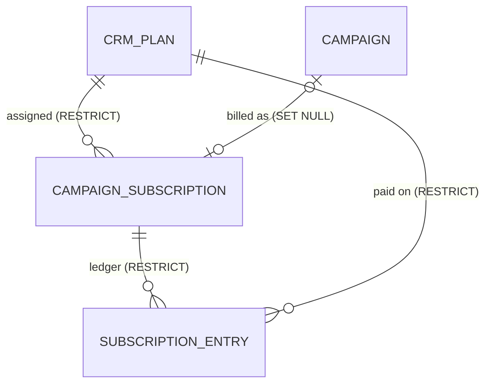

# Release 3: Manual CRM Subscriptions

Technical design for Release 3 of `docs/Implementation_Plan.md`. It builds on
`docs/Identity_Access_Design.md` (Releases 0 and 1) and
`docs/Aspirants_Design.md` (Release 2) and keeps their principles: campaign
access comes only from `campaign_members`, party access only from
`party_roles`, and nothing in `api/scope.py` reads a party table.

Status: approved 1 November 2026.

Decisions taken by Jeremy on 1 November 2026:

1. **Timeline after the paid period ends**: 7 days of grace with full access
   and a banner, then 7 days read-only, then locked. Both lengths are party
   settings the finance officer edits ("Access state").
2. **Every campaign needs a subscription**, console campaigns included. The
   existing local campaigns start as pending payment (locked) until a payment is
   recorded; the demo seed records one ("Data model", R3-1).
3. **A new workspace starts as pending payment**: locked except its payment
   screen, until the first payment is recorded. No free trial ("Access state").
4. **Public sign-up links close while a campaign is read-only or locked.** A
   supporter's own withdrawal link always works ("Campaign access").

Settled by this design, not a decision: the finance record outlives the
campaign. Deleting a campaign keeps its subscription and ledger, with the
campaign link cleared and its title kept, so revenue reports stay true.

---

## 1. What exists today

| Piece | Where | What R3 relies on |
|---|---|---|
| Campaign access check | `api/deps.py` `get_current_user` | One query per request for a campaign login; raises `CampaignClosed` (403 `campaign_suspended`) while the aspirant is not approved |
| Signed-in only routes | `api/deps.py` `get_signed_in_user`; `/api/auth/me/`, `/api/auth/logout/` | Pinned by `tests/test_route_guards.py` `SIGNED_IN_ONLY` |
| Closed error shape | `api/errors.py` `_campaign_closed`, `services/errors.py` `CampaignClosed` | `{"detail", "code"}`; the code is fixed today |
| Public sign-up links | `api/routers/join.py` `Link.open` (`:63`), `_link` (`:75`) | Reads the aspirant status into a plain field; withdrawal (`:217`) does not use `Link` |
| Campaign creation | `services/campaigns.py` `build_campaign` (`:34`), called by `services/admin.py` `build_workspace` (`:397`) and `create_campaign` (`:422`); `seed/demo.py:119` | Every path builds a `Campaign` |
| Campaign deletion | `services/admin.py` `remove_campaign` (`:361`) | Deletes logins, then the campaign |
| Party offices | `models/enums.py` `PartyRoleName.FINANCE_OFFICER` (`:36`), `api/deps.py` `require_party_role` | The office exists and can be granted; nothing uses it |
| Own record | `services/errors.py` `refuse_own_record` | Superuser exempt |
| Party settings | `models/party.py` `PartySettings` | One row, id 1 |
| Audit | `services/audit.py` `record`, `record_if` | |
| Portal menu | `frontend/src/pages/party/Portal.jsx:13-15` | One entry per office |
| Closed screen | `frontend/src/Gate.jsx` `SignedIn`, `components/CampaignClosed.jsx` | Branches on `error.code` |
| Test campaigns | `tests/conftest.py:282`, `tests/factories.py:105,118`; service-only tests in `test_mca_counting.py`, `test_targets_service.py`, `test_models.py` | Built directly with `Campaign(...)` |

Nothing billing-related exists yet: no plan, subscription or payment table, no
route, no screen. `api/routers/payments.py` is mobilizer payouts, a separate
feature that R3 does not touch.

---

## 2. Design

### Principles

1. **One stored fact, one computed state.** The database stores the last paid
   day, an optional hold, and a ledger. The access state is computed from those
   and today's date by one pure function, so expiry needs no scheduled job and
   the same inputs always give the same state.
2. **The ledger is the truth.** `paid_until` always equals the `paid_until_after`
   of the latest entry that has not been voided, or NULL when there is none.
   Every write keeps that true in the same transaction.
3. **Fail closed.** A campaign login whose campaign has no subscription row is
   treated as locked.
4. **Finance is party data.** Plans, amounts and the ledger are visible to the
   finance officer and the superuser only. Inside a campaign, the candidate and
   manager see their own plan and price; a mobilizer sees only the state and the
   dates.
5. **No officer acts on their own campaign's money.** A finance officer linked
   to a campaign's aspirant cannot change that campaign's subscription.

### Data model



All of it lands in **one** revision, `subscriptions`, on top of `aspirants`.

#### `crm_plans`

| Column | Rule |
|---|---|
| `id` | UUID PK |
| `name` | `varchar(80)`, unique `uq_crm_plans_name` |
| `price_kes` | integer, `CHECK (price_kes >= 0)` |
| `duration_days` | integer, `CHECK (duration_days BETWEEN 1 AND 730)` |
| `description` | text, default `''` |
| `active` | boolean, default true |
| `created_at`, `updated_at` | |

A plan is never deleted; it is deactivated. An inactive plan cannot be newly
assigned. A campaign already on it keeps it and can still renew on it.

#### `campaign_subscriptions`

| Column | Rule |
|---|---|
| `id` | UUID PK |
| `campaign_id` | FK campaigns, NULL, unique `uq_campaign_subscriptions_campaign_id`, `ON DELETE SET NULL` |
| `campaign_title` | `varchar(150)`, written by `remove_campaign` just before the delete, so a closed record keeps its name |
| `plan_id` | FK `crm_plans`, NULL, `ON DELETE RESTRICT` |
| `paid_until` | date NULL: the last day of paid access, inclusive |
| `hold` | `none, suspended, cancelled`, default `none` |
| `hold_reason` | text NULL, `CHECK ((hold = 'none') = (hold_reason IS NULL))` |
| `created_at`, `updated_at` | |

`Campaign.__init__` sets `subscription = CampaignSubscription()` when none is
given, so `build_campaign`, the seed and every test that builds a `Campaign`
get a row without a code change. Unique on a nullable column allows many NULLs
on both databases, so closed records do not clash.

The migration inserts a row for every existing campaign: no plan, `paid_until`
NULL, so pending payment (decision 2).

#### `subscription_entries`

| Column | Rule |
|---|---|
| `id` | UUID PK |
| `subscription_id` | FK `campaign_subscriptions`, NOT NULL, `ON DELETE RESTRICT` |
| `kind` | `payment, extension` |
| `plan_id` | FK `crm_plans` NULL, `ON DELETE RESTRICT`; the plan paid on |
| `amount_kes` | integer NULL |
| `method` | `mpesa, bank, cash, other`, NULL |
| `reference` | `varchar(40)` NULL, stored trimmed and upper-cased |
| `received_on` | date NOT NULL: the day the money arrived, or the day an extension was granted |
| `days` | integer, `CHECK (days BETWEEN 1 AND 730)` |
| `paid_until_before` | date NULL |
| `paid_until_after` | date NOT NULL |
| `note` | text, default `''`; required for an extension |
| `recorded_by_id` | FK users `SET NULL` |
| `created_at` | |
| `voided_at`, `voided_by_id`, `void_reason` | NULL until voided; `voided_by_id` FK users `SET NULL` |

CHECK `entry_shape`, written out:

```sql
(kind = 'payment' AND amount_kes > 0 AND method IS NOT NULL AND reference IS NOT NULL
   AND plan_id IS NOT NULL)
OR (kind = 'extension' AND amount_kes IS NULL AND method IS NULL AND reference IS NULL)
```

Partial unique index `uq_subscription_entries_reference` on `reference`,
declared with `sqlite_where` and `postgresql_where`:
`kind = 'payment' AND voided_at IS NULL`. The same M-Pesa code cannot be
recorded twice; a voided entry frees its code to be entered again correctly.
Index on `(subscription_id, created_at)`.

`api/errors.py` maps it to 400: (`uq_subscription_entries_reference`,
`subscription_entries.reference`) → "That payment reference is already
recorded." and (`uq_crm_plans_name`, `crm_plans.name`) → "A plan with that
name already exists."

#### `party_settings`, three new columns

| Column | Rule |
|---|---|
| `grace_days` | integer, default 7, `CHECK (grace_days BETWEEN 0 AND 60)` |
| `read_only_days` | integer, default 7, `CHECK (read_only_days BETWEEN 0 AND 60)` |
| `payment_instructions` | text, default `''`: how to pay, shown on the payment screen |

`GET /api/party/` does not return them; the finance settings route does.

### Access state

`services/billing.py` `access(subscription, today, grace_days, read_only_days)`
returns `Access(state, paid_until, read_only_from, locks_on)`. `P` is
`paid_until`, `G` is `grace_days`, `R` is `read_only_days`, `T` is today.

| State | When (first match wins) | Campaign access |
|---|---|---|
| `cancelled` | `hold = cancelled` | Locked |
| `locked` | `hold = suspended` | Locked |
| `pending_payment` | `P` is NULL | Locked (decision 3) |
| `active` | `T <= P` | Full |
| `grace_period` | `T <= P + G` | Full, with a banner |
| `read_only` | `T <= P + G + R` | Reads only, with a banner |
| `locked` | otherwise | Locked |

`read_only_from` is `P + G + 1`, `locks_on` is `P + G + R + 1`; both NULL when
`P` is NULL. With `G = 0` there is no grace day; with `R = 0` there is no
read-only day. "Locked" means every campaign route answers 403 except the
subscription read below.

**Today** is the calendar date in Nairobi (UTC+3, no daylight saving), from
`billing.today()`, which uses a fixed `timezone(timedelta(hours=3))` and needs
no time-zone database. Routes take it through a `Today` dependency
(`api/deps.py` `get_today`) so tests override one function to move the clock.

### Recording money

All ledger writes lock the subscription row (`FOR UPDATE`) first, so two
officers recording at once queue, and each write reads the `paid_until` the
previous one left.

**Payment** (`amount_kes > 0`, `method`, `reference`, `received_on`, `note`):
needs a plan on the subscription; `received_on` may not be after today. With
`D` the plan's `duration_days`:

- `start = received_on` when `P` is NULL, else `max(P + 1, received_on)`
- `paid_until_after = start + D - 1`

Paying early stacks on the paid period; paying after it ran out starts from the
day the money arrived, so no paid day is lost and none is back-dated. The amount
is whatever arrived; it is recorded, not checked against the price (risk 5).

**Extension** (`days` 1-365, `note` required): the same formula with
`received_on = today` and `D = days`. No money, not in revenue.

**Void** (`reason` required): only the latest non-voided entry, and only while
`subscription.paid_until` still equals its `paid_until_after` (a conditional
`UPDATE`; zero rows → refused). Sets `paid_until` back to `paid_until_before`.
To void an older entry, void the newer ones first.

**Hold** (`hold`, `reason`): `none` → `suspended` or `cancelled` needs a reason;
→ `none` clears it. Moving between holds is allowed. It never touches
`paid_until`, so lifting a hold restores exactly the state the dates give.

**Plan**: `PUT` sets `plan_id` to an active plan. It changes the next payment's
duration only; past entries keep their own `plan_id`.

Every write is audited: `finance.plan.create`, `finance.plan.update`,
`finance.subscription.plan`, `finance.subscription.payment`,
`finance.subscription.extension`, `finance.subscription.void`,
`finance.subscription.hold`, `finance.settings`. Detail holds ids, plan ids,
amounts, days, dates and hold values; never a reference or a note.

### Campaign access

`get_current_user` keeps its single query, now also selecting the
subscription's `paid_until` and `hold` (outer join from `campaign_members`) and
`grace_days`, `read_only_days` from `party_settings`. It takes the `Request` and
`Today`. Order of checks for a login with a campaign role (not the superuser):

1. Aspirant not approved → 403 `campaign_suspended` (unchanged).
2. No subscription row, or `access(...)` is `pending_payment`, `locked` or
   `cancelled` → 403 `campaign_locked`, "This campaign's subscription is not
   active."
3. `read_only` and the request method is not `GET`, `HEAD` or `OPTIONS` → 403
   `campaign_read_only`, "This campaign is read-only until its subscription is
   renewed."

`CampaignClosed` gains a `code` argument (default `campaign_suspended`) and the
handler sends it, so one handler serves all three. The read-only rule keys on
the method, so a write route added later is covered without being listed.
`tests/test_route_guards.py` pins `CAMPAIGN_READS`, the set of every `GET`
route on a campaign router (each one reviewed to write nothing), and fails
when a `GET` route appears that the set does not hold.

`GET /api/subscription/` uses `get_signed_in_user`, so it answers while
locked. It needs a campaign role (403 otherwise) and returns `state`,
`paid_until`, `read_only_from`, `locks_on`, `hold_reason` when held, and the
party's `payment_instructions`. For the candidate and the manager it adds
`plan {name, price_kes, duration_days}` and `last_paid_on`.
`tests/test_route_guards.py` `SIGNED_IN_ONLY` gains it.

Public sign-up (decision 4): `_link` reads the subscription in the same query
as the aspirant and stores the computed state on `Link`; `Link.open` is false
unless the state is `active` or `grace_period`. The public answer is the same
as any closed link. `POST /api/join/withdraw/{code}/` is untouched, so a
supporter can always remove themselves.

### Permissions

Every finance route first runs `require_party_role(FINANCE_OFFICER)`:
`FinanceOfficer = require_party_role(PartyRoleName.FINANCE_OFFICER)`.

| Route | Anyone | Campaign user | Membership / nominations officer | Finance officer | Superuser |
|---|---|---|---|---|---|
| `GET /api/party/finance/plans/` | 401 | 403 | 403 | yes | yes |
| `POST /api/party/finance/plans/` | 401 | 403 | 403 | yes, audited | yes, audited |
| `PATCH /api/party/finance/plans/{id}/` | 401 | 403 | 403 | yes, audited | yes, audited |
| `GET /api/party/finance/subscriptions/` (state, q; page) | 401 | 403 | 403 | yes | yes |
| `GET /api/party/finance/subscriptions/{id}/` (with ledger) | 401 | 403 | 403 | yes | yes |
| `PUT /api/party/finance/subscriptions/{id}/plan/` | 401 | 403 | 403 | yes, audited, not own | yes, audited |
| `POST /api/party/finance/subscriptions/{id}/payments/` | 401 | 403 | 403 | yes, audited, not own | yes, audited |
| `POST /api/party/finance/subscriptions/{id}/extensions/` | 401 | 403 | 403 | yes, audited, not own | yes, audited |
| `POST /api/party/finance/subscriptions/{id}/entries/{entry}/void/` | 401 | 403 | 403 | yes, audited, not own | yes, audited |
| `PUT /api/party/finance/subscriptions/{id}/hold/` | 401 | 403 | 403 | yes, audited, not own | yes, audited |
| `GET`, `PUT /api/party/finance/settings/` | 401 | 403 | 403 | yes, `PUT` audited | yes, `PUT` audited |
| `GET /api/party/finance/reports/revenue/?from=&to=` | 401 | 403 | 403 | yes | yes |
| `GET /api/party/finance/reports/expiring/?days=` | 401 | 403 | 403 | yes | yes |
| `GET /api/subscription/` | 401 | own campaign (plan and price: candidate, manager) | 403 | 403 | 403 |
| Campaign routes while read-only | | 403 `campaign_read_only` on writes | | | console unchanged |
| Campaign routes while locked, pending or cancelled | | 403 `campaign_locked` | | | console unchanged |

"Not own": refused with 403 when the officer's `party_member_id` equals the
member of the campaign's aspirant (`refuse_own_record`). A console campaign has
no aspirant, so nobody is refused on it.

The subscription list returns per row: id, campaign id (NULL once deleted),
title, seat, area name, candidate name, plan name, `paid_until`, state, hold.
The state is computed in Python over the rows (risk 4), then filtered and paged.
Never a phone or a supporter count.

Reports:
- **Revenue**: non-voided payments with `received_on` in `[from, to]` (default
  the current calendar year), as a total, a count, a row per month and a row
  per plan.
- **Expiring**: subscriptions in `grace_period` or `read_only`, and `active`
  ones whose `paid_until` is within `days` (default 14, at most 90), ordered by
  `paid_until`.

### Frontend

| Where | Change |
|---|---|
| `pages/party/Portal.jsx` | Menu entry `["finance", "Finance", "finance_officer", <Finance />]`; the superuser gets it with the others |
| `pages/party/Finance.jsx` | Four tabs. **Campaigns**: state filter, search, table; a detail panel with plan picker, "Record payment" (amount defaults to the plan price), "Extend", hold with reason, and the ledger with "Void" on the latest entry. **Plans**: list, create, edit, deactivate. **Reports**: revenue by month and plan for a date range; expiring list. **Settings**: grace days, read-only days, payment instructions |
| `components/CampaignLocked.jsx` | For `campaign_locked`: the state in words, paid until, plan and amount (candidate, manager), the payment instructions, sign out |
| `Gate.jsx` | `campaigns.error?.code === "campaign_locked"` → `CampaignLocked` |
| `components/AccessBanner.jsx`, `App.jsx` | Reads `GET /api/subscription/`. Grace: "The subscription ended on {P}. Renew by {read_only_from} to keep editing." Read-only: "Read-only since {read_only_from}. Renew to edit again; the workspace locks on {locks_on}." Nothing while active |
| Write errors | A `campaign_read_only` refusal shows the server's sentence where the form shows errors today; no extra handling |

Dates show as "3 Nov 2026".

---

## 3. Tickets

The migration runs first and alone (R3-1). Tickets that share files run one
after the other. A route enters `contracts/frontend-api.json` in the frontend
ticket that first calls it (`frontend/tests/contract.test.js` checks both ways):
R3-5 for the finance routes, R3-6 for `GET /api/subscription/` and the two new
codes. A frontend ticket starts after the backend tickets it calls have merged.
Officers in tests come from `make_officer(session, world, FINANCE_OFFICER)`.

**R3-1 Plans, subscriptions and the ledger** (schema) — done 1 Nov 2026
- Files: new `models/billing.py`, `models/enums.py` (`SubscriptionHold`, `EntryKind`, `PaymentMethod`), `models/campaign.py` (relationship and the default row), `models/party.py` (three settings columns), `models/__init__.py`, new revision `subscriptions` (tables, backfill), `api/errors.py` (two constraint messages), `tests/test_models.py`.
- Tests: a payment entry without a reference fails at the database; the same reference twice fails, and succeeds once the first is voided; a new `Campaign` has a subscription row.

**R3-2 Access follows the subscription** (backend) — done 1 Nov 2026
- Files: new `services/billing.py` (`today`, `access`), `services/errors.py` (`CampaignClosed` code), `api/deps.py` (`get_today`, `Today`, the access check), `api/errors.py`, `api/routers/join.py`, `tests/conftest.py` and `tests/factories.py` (test campaigns get a paid subscription running a year past the fixed test date), `tests/test_route_guards.py`, new `tests/test_subscription_access.py`, new `evals/test_access_timeline.py`.
- Tests: a read-only campaign answers a `GET` and refuses a `POST` with `campaign_read_only`; a locked one refuses both with `campaign_locked` and still answers `/me`; its sign-up link is closed and a supporter's withdrawal still works.
- Eval: walks every day from `P - 1` to `P + G + R + 1` for `(G, R)` in `(7, 7), (0, 7), (7, 0), (0, 0)` and checks the state sequence, and the HTTP answer to one read and one write, on each day.

**R3-3 Finance API** (backend)
- Files: `services/billing.py` (plans, plan, payment, extension, void, hold, settings), new `schemas/billing.py`, new `api/routers/party_finance.py`, `api/routers/__init__.py`, `api/deps.py` (`FinanceOfficer`), `services/admin.py` (`remove_campaign` writes `campaign_title`), new `tests/test_party_finance_api.py`.
- Tests: a payment on a lapsed subscription starts on the day received and makes it active; an early payment stacks on the paid period; voiding the latest entry restores the previous `paid_until`, and voiding an older one is refused; a hold locks and lifting it restores the dated state; a nominations officer gets 403; a finance officer on their own campaign gets 403; deleting a campaign keeps its ledger.
- The concurrent payment test runs in the Postgres lane.

**R3-4 Reports and the campaign's own view** (backend)
- Files: `services/billing.py` (revenue, expiring), `api/routers/party_finance.py`, new `api/routers/subscription.py`, `api/routers/__init__.py`, `tests/test_route_guards.py` (`SIGNED_IN_ONLY`), tests.
- Tests: revenue leaves out voided payments and extensions; the expiring list holds grace and read-only campaigns and active ones due within the window; a mobilizer's `/api/subscription/` has no plan or price.

**R3-5 Finance page** (frontend)
- Files: new `pages/party/Finance.jsx`, `pages/party/Portal.jsx`, `api/hooks`, `contracts/frontend-api.json` (finance routes), tests.
- Tests: a finance officer sees Finance and not Members; recording a payment, voiding and holding call the right routes; the amount defaults to the plan price.
- Depends: R3-3, R3-4 merged.

**R3-6 Banner and payment screen** (frontend)
- Files: new `components/CampaignLocked.jsx`, new `components/AccessBanner.jsx`, `Gate.jsx`, `App.jsx`, `contracts/frontend-api.json` (`/api/subscription/`, `campaign_locked`, `campaign_read_only`), tests.
- Tests: a locked campaign shows the payment screen with the instructions; a read-only campaign shows the banner with the lock date.
- Depends: R3-2, R3-4 merged.

**R3-7 Integration** (lead)
- `seed/demo.py` (a plan and a payment for the demo campaign); both test lanes, the contract evals, the guard inventory; `docs/SYSTEM.md` (features table, business rules, "Planned, not built" loses the subscription row); cold isolation critic against section 4.

---

## 4. Rubric for the release critic (frozen before building)

1. For every day from one before the paid period ends to one after it locks, and for zero and non-zero grace and read-only lengths, the state and the HTTP answers match the table in "Access state".
2. A read-only campaign refuses every non-`GET` campaign route with `campaign_read_only` for every login on it; a locked, pending or cancelled one refuses every campaign route with `campaign_locked`; `/me`, logout and `/api/subscription/` still answer.
3. Public sign-up links are closed unless the state is active or grace; a supporter's withdrawal always works.
4. `paid_until` always equals the latest non-voided entry's `paid_until_after`, or NULL with none, after any sequence of payments, extensions and voids, including two officers recording at once.
5. A payment never back-dates access and never loses a paid day; the same reference cannot be recorded twice while live.
6. Every route answers as the permissions table says, for anonymous, candidate, manager, mobilizer, each office, an unlinked finance officer, a finance officer on their own campaign, and the superuser.
7. A mobilizer never sees a plan, price or amount; no party staff other than the finance officer and the superuser sees any finance route.
8. Deleting a campaign keeps its subscription and ledger, titled, and its payments stay in the revenue report.
9. A campaign with no subscription row is locked.
10. Audit detail never holds a payment reference or a note.
11. Both test lanes pass; existing campaign, membership, volunteer and aspirant tests pass unchanged except where this design changes the behaviour.

---

## 5. Risks

| # | Risk | Effect if missed | Mitigation |
|---|---|---|---|
| 1 | A write route reached by `GET` | Edits while read-only | The rule keys on the method; `CAMPAIGN_READS` makes every new campaign `GET` route a reviewed addition |
| 2 | Clock or time-zone slip at midnight | A campaign locks a few hours early or late | One `today()` in Nairobi time; the timeline eval walks the boundary days |
| 3 | A new campaign path skips the subscription row | That campaign is locked | Fail closed: the row comes from `Campaign.__init__`, and a missing row reads as locked, never open |
| 4 | State computed in Python for the list | Slow with many campaigns | Fine for a party's hundreds of campaigns; move to SQL if it passes a few thousand |
| 5 | Any amount extends a full period | A wrong amount buys a full period | Intended for manual payments; every entry is audited and shown in the ledger and revenue report; void corrects it |
| 6 | Voiding an older entry | Ledger and `paid_until` disagree | Only the latest live entry can be voided, conditional on `paid_until` |
| 7 | Changing grace or read-only days | Every campaign's state moves at once | Intended; audited; the settings tab says so |
| 8 | Existing local campaigns lock on migration | The R2 demo stops until paid | Decision 2; no real data; the demo seed records a payment |
| 9 | The access check grows | Slower requests | Still one query: an outer join and the one settings row |
